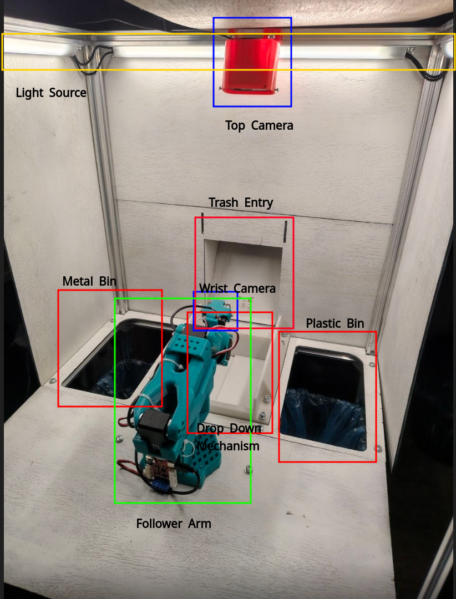
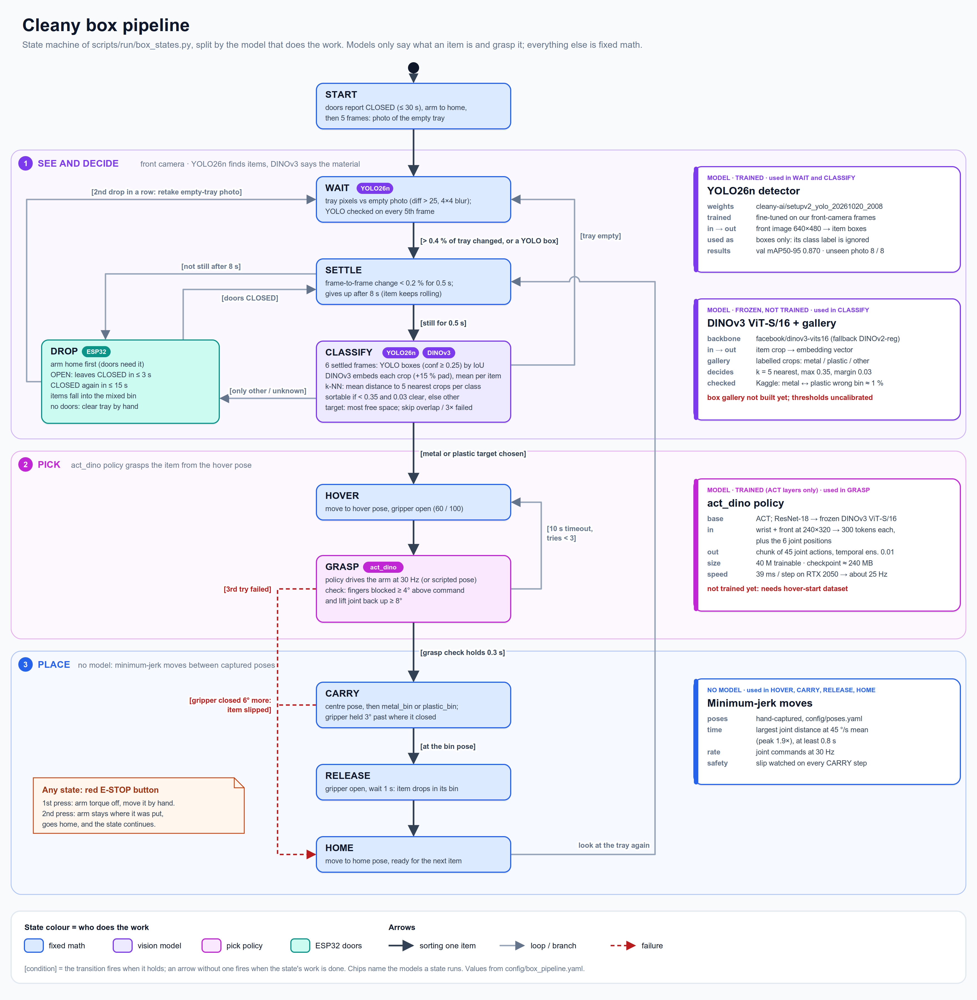

# 🤖 Cleany: AI trash sorting robot

An SO-101 robot arm in a closed box that takes an item from a tray, decides whether it is **metal**,
**plastic** or something else, and puts it into the matching bin (or lets the trap doors drop it into a
mixed bin). Models only say *what an item is* (YOLO boxes + DINOv3 embeddings) and *grasp it* (one pick
model); every other move is a scripted motion between named poses, driven by a state machine and the ESP32
doors. Built with [LeRobot](https://github.com/huggingface/lerobot) from
[`ucu-ai-course/project-template`](https://github.com/ucu-ai-course/project-template).

> [!note] Status
> The state machine, classifier, recorder and all tools are done and tested; the dry run on recorded video is
> checked. **It has not run on the arm yet, and the pick model is not trained yet**: its dataset is being
> recorded (6 test episodes so far). The earlier open-table setup (setup v2, two ACT policies, one per
> material) is not part of this repository any more; its datasets and models stay on the
> [Hub](https://huggingface.co/cleany-ai) and in git history.


## Demo

> [!note]
> The demo GIF of the full pipeline on the arm is not recorded yet: see
> [docs/recording-a-demo.md](docs/recording-a-demo.md). Until then, the setup:



*The item enters at the top, the front camera looks down at the tray, the arm lifts it to a bin, and doors
under the tray drop what cannot be sorted into a mixed bin.*

## Team

| Name | GitHub | Role |
|---|---|---|
| Yelyzaveta Bugir | [@lizabugirr](https://github.com/lizabugirr) | YOLO (data, labelling, training, evaluation), ACT training and publishing, sorting pipeline, repository |
| Nazar Pasichnyk | [@dark-neonus](https://github.com/dark-neonus) | Setup and electronics, cameras, dataset recording tools, ACT training tools, pipeline visualisation |

## Problem and motivation

Sorting household trash by material is repetitive work that recycling depends on, and the
items are messy: crushed cans, transparent bottles, caps, odd plastic parts, each lying in a
different pose. A fixed, hand-programmed pick motion does not cope with that variety, but a
policy learned from a few dozen human demonstrations might. The project asks whether a cheap
6-DoF arm (SO-101) plus a laptop GPU can learn to pick one item at a time, with a vision model
deciding where it goes and everything else scripted, so that only two models have to be right.

## Data

Recorded by us on the arm, in the box (no external data in the final models). The **pick dataset**
(hover pose to item lifted, all materials) is recorded with `scripts/dataset/record_pick.sh` and kept as two
private Hub repos, laid out the same way locally under `data/pick/`:

| Repo | Local | Contents |
|---|---|---|
| [`cleany-ai/cleany_pick`](https://huggingface.co/datasets/cleany-ai/cleany_pick) (private) | `data/pick/episodes/` | LeRobot episodes: front and wrist camera, normalised joint positions, velocity / current / load / temperature / voltage, the item's DINO embedding and box; task = material. **6 test episodes so far**; the real collection ([plan](docs/collection-plan.md): 23 / 22 / 15 episodes for the pilot, then 90 / 90 / 60 metal / plastic / other) has not started |
| [`cleany-ai/cleany_pick_items`](https://huggingface.co/datasets/cleany-ai/cleany_pick_items) (private) | `data/pick/items/` | `records.jsonl` (each record's `item_id`), `registry/` (the [object library](objects/README.md) and its train/test split), `crops/` for the DINO gallery, `yolo/` labelled frames |

The train/test split is by item design ([objects/](objects/README.md): `train/` is shown in the recorder's object library and must be chosen for every record, `test/` is held out): held-out items are refused by the recorder and checked by `scripts/tools/check_split.sh`.
What is recorded and what ACT trains on: [docs/pick-dataset.md](docs/pick-dataset.md).

## Approach

### Box pipeline



- **See and decide.** The front camera is compared with a photo of the empty tray; when something
  changed and sits still, YOLO26n draws a box around every item (its class is ignored) and DINOv3
  embeds each crop. The material is the class of the nearest crops in a gallery built in the box;
  an item that is not clearly one of them is `other`. A wrong bin is worse than the mixed bin.
- **Pick.** One pick model (ACT with a frozen DINO encoder, `act_dino`) grasps the item from the
  `hover` pose. A grasp check (fingers blocked by the item, arm lifted) decides if it worked.
- **Place.** No model: scripted moves between poses captured by hand (`home`, `hover`, `transit`,
  `metal_bin`, `plastic_bin`) with a trapezoidal speed profile, a slip check while carrying, the
  ESP32 doors for `other` items, and a red emergency stop that releases the torque.

## Quick start

```bash
git clone https://github.com/dark-neonus/Cleany_AI_Trash_Sorting_Robot && cd Cleany_AI_Trash_Sorting_Robot
make setup                    # system packages, .venv (Python 3.12, LeRobot, YOLO, DINO), dev tools; needs sudo
.venv/bin/hf auth login       # account in the cleany-ai organization (the pick datasets are private)
```

No arm needed (a simulated arm and door, the front camera or a recorded video):

```bash
scripts/run/run_box_pipeline.sh --recording false --dry-run --display
scripts/tools/capture_poses.sh --list      # which poses are captured and whether they look right
scripts/tools/check_split.sh               # no held-out item in the pick data
```

With the hardware plugged in (follower and leader arms, front and wrist cameras, ESP32 doors for the drop):

```bash
scripts/tools/capture_poses.sh             # once per setup: the arm's named poses
scripts/dataset/record_pick.sh             # record the pick dataset, with a panel
scripts/run/run_box_pipeline.sh --recording true --display   # the box pipeline (scripted grasp until the pick model exists)
```

Everything is in [Commands](#commands) below.

## Documentation

| Guide | What it covers |
|---|---|
| [docs/scripts.md](docs/scripts.md) | Every script in `scripts/` |
| [docs/cameras.md](docs/cameras.md) | Camera settings and recording performance |
| [docs/training.md](docs/training.md) | Training the pick model, resuming, sharing models |
| [docs/box-pipeline.md](docs/box-pipeline.md) | The final box pipeline: DINO classifier, one grasp model, scripted moves, doors; poses, gallery, running |
| [docs/pick-dataset.md](docs/pick-dataset.md) | The pick dataset: what is recorded, the recorder panel step by step, labelling, Hub layout |
| [docs/collection-plan.md](docs/collection-plan.md) | How much data of which items, the train/test split by item design, the tools |
| [docs/motion.md](docs/motion.md) | Scripted arm moves: acceleration ramps, approach paths, what was measured |
| [docs/yolo.md](docs/yolo.md) | Using and retraining the detector, labelling new frames |
| [docs/cloud-storage.md](docs/cloud-storage.md) | Hugging Face Hub setup, dataset sync, team rules |
| [electronics/ELECTRONICS.md](electronics/ELECTRONICS.md) | Hardware and power supply |

## Repository structure

```
.
├── scripts/              # all code, by task: setup/ calibration/ teleop/ dataset/ train/ run/ yolo/ tools/,
│                         #   shared config/ (ports, cameras, datasets) and common/ (helpers)
├── config/               # default.yaml (models, datasets), box_pipeline.yaml (trigger, classifier, motion, doors),
│                         #   pick_recording.yaml (recorder), poses.yaml (captured poses), item_labels.yaml
├── tests/                # pytest: state machine, recorder, classifier, poses, motion, config
├── data/                 # datasets NOT committed; data/pick/{episodes,items,sheets}: the pick dataset; data/archive/: older setups
├── models/               # weights NOT committed; models/README.md (Hub instructions) IS
├── objects/              # the object library: train/<id>/ and test/<id>/ (picture + item.yaml), objects/README.md
├── docs/                 # guides, CONTRIBUTING.md, proposal/, poster/, slides/
├── calibration/          # arm calibration, shared by everyone using the same arms
├── electronics/          # wiring and power
├── assets/               # photos of the setup
└── .github/workflows/    # lint.yml
```

Generated and git-ignored: `outputs/` (training runs), `recordings/` (runs on the arm),
`logs/` (pipeline events), `yolo/` (frames, YOLO datasets, Label Studio).

## Reproducibility

- **Models and data** are pinned by Hub repo and commit: `config/default.yaml` names the models and datasets.
- **Versions**: Python 3.12; `requirements.txt` pins the packages (LeRobot 0.6.1, PyTorch 2.11 + CUDA 12.8,
  Ultralytics 8.4.178, transformers for DINO).
- **Seeds**: LeRobot ACT training uses seed 1000 (recorded in each model's `train_config.json`); YOLO trains
  with Ultralytics' default seed 0 in deterministic mode.
- **Hardware tested on**: Ubuntu 26.04, NVIDIA RTX 2050 (4 GB); the DINO pick model trains at about 0.8 s per
  step there.
- **What cannot be re-run from git alone**: anything on the arm. It depends on the physical setup (box, camera
  positions, lighting, calibration, captured poses), which is why every model name carries the setup name
  (`setupv3_…`).

## Commands

All scripts can be run from any directory. Details of each: [docs/scripts.md](docs/scripts.md).

### Set up the box (once per setup)

```bash
make setup                                 # system packages, .venv, LeRobot, YOLO, transformers (DINO)
scripts/calibration/calibrate_follower.sh  # and calibrate_leader.sh
scripts/tools/tune_cameras.sh              # lock exposure / white balance to the box light
scripts/tools/capture_poses.sh             # a live panel; --hand: torque off, move the follower by hand; --list: check them
scripts/tools/show_poses.sh walk           # the arm visits every pose: the first real test (--dry-run without the arm)
```

DINOv3 is a gated model: accept its licence on the Hub and run `hf auth login`, otherwise DINOv2 is used with a warning.

### Record the pick dataset

```bash
scripts/dataset/sync.sh pull pick          # the shared copy (skip for the first session)
scripts/dataset/record_pick.sh             # panel: both cameras live, item picker, progress against the targets
scripts/tools/contact_sheet.sh             # after a session: one image of every record's crop, to check them
scripts/tools/check_split.sh               # fails if a held-out item got into the data
scripts/tools/data_report.sh               # docs/reports/data_<date>.md: records per object, to commit next to a model
scripts/dataset/sync.sh push pick          # cleany_pick (episodes) + cleany_pick_items (records, registry, crops, YOLO frames)
```

Options: `--door none` (no drop mechanism: empty the tray by hand), `--max-velocity`, `--acceleration`,
`--max-step`. The panel's buttons are Metal (M), Plastic (P), **Pick other** (G, a pick episode) and Save other (O, picture only);
Space / Esc / Backspace start, cancel and discard; the red button is the emergency stop; **S** takes a
screenshot of both cameras. The leader's gripper servo is a 12 V model on a 5 V supply and is never driven by the
script (`start.drive_leader_gripper: false`): the follower's gripper opens to 30 by itself and then follows your
trigger. Step by step and what the panel shows: [docs/pick-dataset.md](docs/pick-dataset.md).

### Run the box pipeline

```bash
scripts/tools/build_gallery.sh --crops data/pick/items/crops   # DINO gallery from the recorded crops; prints how far to set max_distance
scripts/run/run_box_pipeline.sh --recording false --dry-run --display             # simulated arm and door
scripts/run/run_box_pipeline.sh --recording true --display                        # on the arm, scripted grasp (needs the tray_low pose)
GRASP_MODEL=cleany-ai/<pick model> scripts/run/run_box_pipeline.sh --recording true --grasp policy --display
scripts/train/train_act_dino.sh metal --steps=2000                               # the pick model (needs the pick dataset)
```

`--recording true|false` is required; `--door none` without the doors. Stop with `exit` + Enter or Ctrl+C: the arm goes
home first. Every event is logged to `logs/pipeline/box_<timestamp>.jsonl`. Tuning (tray region, gallery thresholds,
speeds, `motion.ramp_s`): [docs/box-pipeline.md](docs/box-pipeline.md), [docs/motion.md](docs/motion.md).

### Tools

| Command | What it does |
|---|---|
| `scripts/tools/capture_poses.sh [--hand \| --list \| --migrate]` | Capture, check and list the arm's named poses |
| `scripts/tools/show_poses.sh walk \| slideshow \| go <pose>` | Move the arm through the poses |
| `scripts/tools/contact_sheet.sh [--session S] [--items]` | Contact sheets of a session's crops, to check items |
| `python scripts/tools/draw_objects.py` | Draw the object library's boxes on the setup photos (train green, test red) |
| `scripts/tools/check_split.sh` | Verify the train/test split by item design |
| `scripts/tools/data_report.sh [--name N]` | Markdown report of the data collected (`docs/reports/`), with places for the model and its test results |
| `scripts/tools/build_gallery.sh --crops DIR` | Build the DINO gallery and print the held-out evaluation |
| `scripts/dataset/view.sh <dataset dir> [episode]` | Browse an episode (both cameras, joints, actions) in Rerun |
| `scripts/dataset/sync.sh status \| push \| pull [pick]` | Sync datasets with the Hub (`pick` = both pick repos) |
| `scripts/tools/tune_cameras.sh`, `preview_augmentation.sh` | Cameras and augmentation helpers |

To look at the parquet files of a dataset, a desktop viewer such as [Tad](https://github.com/antonycourtney/tad)
works well; `scripts/dataset/view.sh` shows an episode with its videos.

## YOLO detector

YOLO draws a box around every item on the tray in the front-camera image; the box pipeline uses the boxes only
(DINO decides the material). The current weights (`cleany-ai/setupv2_yolo_20261020_2008`) were trained on the old
setup and are to be retrained on the box's own frames (`data/pick/items/yolo`). Using it, retraining it and labelling
new frames: [docs/yolo.md](docs/yolo.md).

## Training the pick model

```bash
scripts/dataset/sync.sh pull pick
scripts/train/train_act_dino.sh pick --steps=2000     # smoke test
scripts/train/train_act_dino.sh pick                  # 50k steps
POLICY=act_dino scripts/train/upload_model.sh pick    # to cleany-ai/setupv3_act_dino_pick_<time>
```

Resuming, augmentation and sharing: [docs/training.md](docs/training.md). What the model sees and why:
[docs/box-pipeline.md](docs/box-pipeline.md#pick-model-act-with-a-dino-encoder).

## Storing datasets in the cloud

### Recommended: private Hugging Face Hub dataset repos

| Option                      | Fit for LeRobot data | Versioning           | Cost / limits          |
| --------------------------- | -------------------- | -------------------- | ---------------------- |
| **Hugging Face Hub**        | Native: training and the dataset viewer load it directly by repo id | Every push is a commit; roll back to any revision | Free private storage up to a quota per account/org |
| Google Drive (via `rclone`) | Plain files only     | None, files are overwritten | Free 15 GB per account |
| S3 / Cloudflare R2          | Plain files only     | Optional bucket versioning | Pay per GB          |
| DVC on top of git           | Plain files only     | Full, tied to git commits | Needs a storage backend anyway |

The Hub is the format LeRobot already uses, so nothing has to be converted: the same repo
can be pulled on any machine (for example a bigger GPU for training) or opened in the
online LeRobot dataset visualizer. Each `push` is a git commit, so a bad upload can be
undone. A LeRobot dataset is a few hundred files (parquet tables + MP4 videos), which suits
the Hub's git/Xet storage much better than Drive.

### One-time setup

1. Create a Hugging Face organization (default name `cleany-ai`; set another in
   `scripts/config/datasets.sh` or via `HF_NAMESPACE=...`) and add the team members.
2. Create an access token with **write** permission at
   https://huggingface.co/settings/tokens and log in on every machine:

   ```bash
   .venv/bin/hf auth login
   ```

Repos are created on the first push, always **private**.

### Sync commands

```bash
scripts/dataset/sync.sh status              # episode and record counts, local vs Hub
scripts/dataset/sync.sh push pick           # upload local → Hub (cleany_pick + cleany_pick_items)
scripts/dataset/sync.sh pull pick           # download Hub → local
```

- `push` uploads the local dataset and makes the Hub copy match it exactly, including
  episodes deleted locally. It refuses if the Hub has more episodes than the local copy.
- `pull` replaces the local copy with the Hub one, keeping the old one in
  `data/pick/episodes.before_pull/`. It refuses if the local copy has more episodes.
- Add `--force` to skip the episode-count check, e.g. to push after deleting episodes:
  `scripts/dataset/sync.sh push pick --force`.

### Team rules

- **Pull before you record, push right after.** The Hub copy is the shared truth.
- **One person records a given model at a time.** LeRobot datasets cannot be merged by
  syncing; two people appending to the same dataset in parallel would overwrite each
  other's episodes. To record the same model on two machines in parallel, the second
  machine pushes to a personal namespace instead
  (`HF_NAMESPACE=<your-user> scripts/dataset/sync.sh push pick`), and the two datasets
  are merged afterwards with `lerobot-edit-dataset --operation.type=merge`.
- Trained models are shared as Hub **model** repos, see
  [docs/training.md](docs/training.md#sharing-trained-models).
