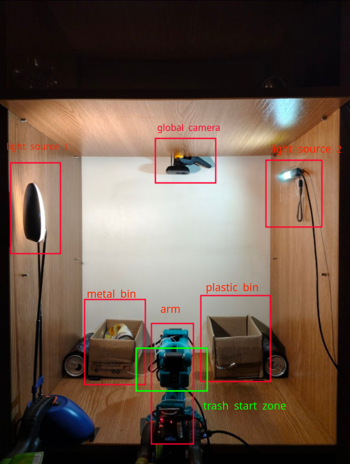
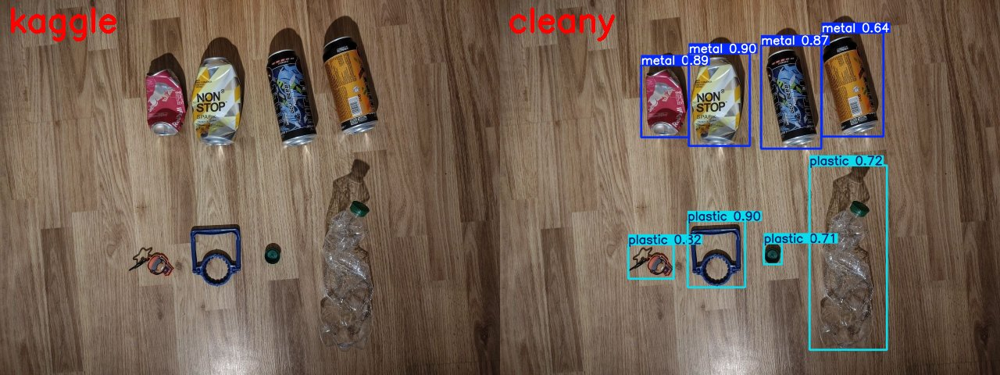
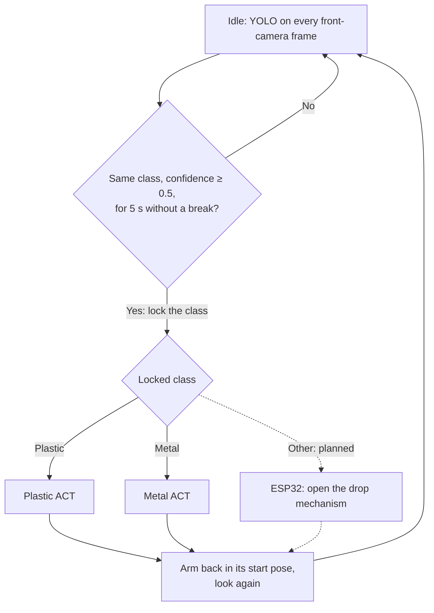
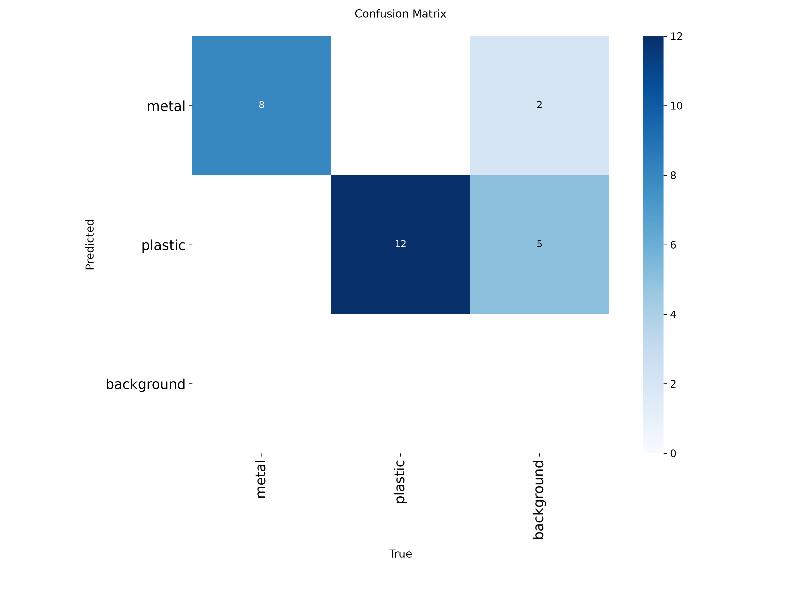

# 🤖 Cleany: AI trash sorting robot

An SO-101 robot arm that looks at an item on the table, recognises whether it is **metal** or
**plastic** with YOLO, and puts it into the matching bin with an ACT imitation-learning policy
trained on our own teleoperated demonstrations. Built with [LeRobot](https://github.com/huggingface/lerobot)
from [`ucu-ai-course/project-template`](https://github.com/ucu-ai-course/project-template).


## Demo

> [!note]
> The demo GIF of the full pipeline on the arm is not recorded yet: see
> [docs/recording-a-demo.md](docs/recording-a-demo.md). Until then, the workspace and what the
> detector sees:





## Team

| Name | GitHub | Role |
|---|---|---|
| Yelyzaveta Bugir | [@lizabugirr](https://github.com/lizabugirr) | YOLO (data, labelling, training, evaluation), ACT training and publishing, sorting pipeline, repository |
| Nazar Pasichnyk | [@dark-neonus](https://github.com/dark-neonus) | Setup and electronics, cameras, dataset recording tools, ACT training tools, pipeline visualisation |

## Problem and motivation

Sorting household trash by material is repetitive work that recycling depends on, and the
items are messy: crushed cans, transparent bottles, caps, odd plastic parts, each lying in a
different pose. A fixed, hand-programmed pick motion does not cope with that variety, but a
policy learned from a few dozen human demonstrations might. The project asks whether a cheap
6-DoF arm (SO-101) plus a laptop GPU can learn to sort one item at a time into a
metal and a plastic bin, with a vision model deciding which policy to run.

## Data

Recorded by us on the arm (no external data in the final models):

| Dataset | Size | Used for |
|---|---|---|
| [`cleany-ai/cleany_plastic`](https://huggingface.co/datasets/cleany-ai/cleany_plastic) | 60 teleoperated episodes, 36 659 frames, 30 fps, 2 cameras | plastic ACT |
| [`cleany-ai/cleany_metal`](https://huggingface.co/datasets/cleany-ai/cleany_metal) | 80 episodes, 43 030 frames | metal ACT |
| [`cleany-ai/cleany_yolo_frames`](https://huggingface.co/datasets/cleany-ai/cleany_yolo_frames) (private) | 100 labelled front-camera frames + 1 unseen test photo | YOLO |

License CC BY 4.0. Full data card (schema, splits, limitations, revisions): [data/README.md](data/README.md).

> [!note] Data and weights are not in git
> `data/` and `models/` hold only their README: the datasets (2.5 GB of video) and the weights
> live on the Hugging Face Hub, versioned by commit, and the scripts download them.

## Approach



- **YOLO decides once, at the start.** Single frames are unreliable while the item still
  moves, so a class is locked only when it wins every frame for a few seconds. Items already in
  a bin are ignored.
- **One ACT policy per material.** The class is chosen by picking the model; each ACT finds the
  item from the two camera images alone and is not given YOLO's box. YOLO is not consulted while
  an ACT runs: the arm hides the item, and switching policies mid-grasp is worse than finishing.
- **Retry, then skip.** If the item is still at the same place afterwards, the ACT tries again;
  after 3 tries the item is skipped until someone moves it.
- **Planned:** an `other` class and an ESP32-driven trap door that drops non-sortable items into
  a mixed bin, once the final box is built.

Models: YOLO26n fine-tuned on our frames (baseline: the same network trained on Kaggle garbage
photos), and two ACT policies (LeRobot 0.6.1, ResNet-18 backbone, action chunks of 100 steps),
100 000 steps each with colour augmentation. Full log, including the rejected runs:
[results/experiments.md](results/experiments.md).

## Results

**YOLO**, generated by `python scripts/yolo/evaluate.py` on 2026-10-23 (`make reproduce`):
validation = 20 held-out episodes; test photo = 8 items shot with another camera on another
table, never used for training.

| Model | Val mAP50-95 | Test photo mAP50-95 | Test photo, items right at conf 0.25 |
|---|---|---|---|
| Baseline: YOLO26n trained on Kaggle photos only | 0.002 | 0.188 | 0 / 8 |
| **YOLO26n fine-tuned on our frames (selected)** | **0.870** | **0.721** | **8 / 8** |
| Same + Kaggle photos in training — *rejected* | 0.869 | 0.653 | 2 plastic items missed |
| YOLO26s (bigger) — *rejected* | 0.858 | 0.655 | 2 extra wrong `metal` boxes |



> [!note] Why the baseline row matters
> The validation numbers saturate (mAP50 = 0.995) because the same cans and bottles appear in
> training and validation episodes. The baseline shows what our own data bought (0.002 → 0.870),
> and the out-of-domain photo is what told the runs apart; one photo with 8 boxes is a small
> test, so we chose on "every item right at the working threshold", not on 0.01 of mAP.

**ACT on the arm** (current pipeline, one item in the start zone, 10 trials per model): plastic
**9/10**, metal **8/10** items put into the right bin. 10 trials is a small sample; larger runs and
new items are next, see [results/experiments.md](results/experiments.md).

## Quick start

```bash
git clone https://github.com/dark-neonus/Cleany_AI_Trash_Sorting_Robot && cd Cleany_AI_Trash_Sorting_Robot
make setup                    # system packages, .venv (Python 3.12, LeRobot, YOLO), dev tools; needs sudo
.venv/bin/hf auth login       # account in the cleany-ai organization (the YOLO frames are private)
make reproduce                # downloads frames + models, prints the YOLO results table above
```

With the hardware (follower arm, front and wrist cameras) plugged in:

```bash
scripts/run/run_pipeline.sh --recording false --dry-run --display    # camera + YOLO only, the arm does not move
scripts/run/run_pipeline.sh --recording true --max-velocity 60 --display   # the full pipeline; stay next to the arm
```

## Documentation

| Guide | What it covers |
|---|---|
| [docs/scripts.md](docs/scripts.md) | Every script in `scripts/` |
| [docs/cameras.md](docs/cameras.md) | Camera settings and recording performance |
| [docs/dataset-collection.md](docs/dataset-collection.md) | Recording, reviewing and cleaning demonstrations |
| [docs/training.md](docs/training.md) | Training ACT, resuming, sharing models |
| [docs/running-models.md](docs/running-models.md) | Available models, downloading, running one ACT on the arm |
| [docs/pipeline.md](docs/pipeline.md) | The sorting pipeline: dry run, on the arm, options |
| [docs/yolo.md](docs/yolo.md) | Using and retraining the detector, labelling new frames |
| [docs/cloud-storage.md](docs/cloud-storage.md) | Hugging Face Hub setup, dataset sync, team rules |
| [electronics/ELECTRONICS.md](electronics/ELECTRONICS.md) | Hardware and power supply |

## Repository structure

```
.
├── scripts/              # all code, by task: setup/ calibration/ teleop/ dataset/ train/ run/ yolo/ tools/,
│                         #   shared config/ (ports, cameras, datasets) and common/ (helpers)
├── config/default.yaml   # which models and datasets the scripts use
├── tests/                # pytest: pipeline decisions, YOLO data split, config
├── data/                 # datasets NOT committed; data/README.md (data card) IS
├── models/               # weights NOT committed; models/README.md (Hub instructions) IS
├── results/              # metrics.json, experiments.md, figures/ — committed, small
├── docs/                 # guides, CONTRIBUTING.md, proposal/, poster/, slides/
├── calibration/          # arm calibration, shared by everyone using the same arms
├── electronics/          # wiring and power
├── assets/               # photos of the setup
└── .github/workflows/    # lint.yml
```

Generated and git-ignored: `outputs/` (training runs), `recordings/` (runs on the arm),
`logs/` (pipeline events), `yolo/` (frames, YOLO datasets, Label Studio).

## Reproducibility

- **Models and data** are pinned by Hub repo and commit: `config/default.yaml` names the models,
  [data/README.md](data/README.md) lists the dataset revisions.
- **Versions**: Python 3.12.14; `requirements.txt` pins the packages (LeRobot 0.6.1,
  PyTorch 2.11 + CUDA 12.8, Ultralytics 8.4.178). `results/metrics.json` records the versions,
  OS and git commit each result was produced with.
- **Seeds**: YOLO trains with Ultralytics' default seed 0 in deterministic mode; LeRobot ACT
  training uses seed 1000 (recorded in each model's `train_config.json`).
- **Hardware tested on**: Ubuntu 26.04, NVIDIA RTX 2050 (4 GB). `make reproduce` takes ~1 min
  and runs on a CPU too; training ACT takes ~18 h per model on that GPU, YOLO ~7 min.
- **What cannot be re-run from git alone**: anything on the arm. It depends on the physical
  setup (bins, camera positions, lighting, calibration), which is why every model name carries
  the setup name (`setupv2_…`).

## Development

```bash
.venv/bin/pytest                          # tests, ~3 s, no GPU or hardware needed
.venv/bin/ruff check scripts tests        # what CI runs
.venv/bin/ruff check scripts tests --fix  # fix import order and unused imports
```

`make setup` installs a pre-commit hook that runs the same check before every commit.
How we branch, commit and review: [docs/CONTRIBUTING.md](docs/CONTRIBUTING.md).

## AI usage

| Tool | Used for | How the result was checked |
|---|---|---|
| Claude (Claude Code) | Writing and debugging scripts: the sorting pipeline, YOLO frame extraction, training and evaluation scripts, run/upload helpers; monitoring long training runs; first drafts of the docs and this README | Scripts run on real data (dry runs on recorded episodes, the ACT step on a replayed episode, evaluation from a fresh Hub download), unit tests in `tests/`; numbers in this README come from `results/metrics.json` |
| Claude (Claude Code) | Proposing YOLO bounding boxes (frame differencing + SAM 2.1) for the 100 training frames | Every box was checked on the image, two were corrected by hand; the class always comes from the dataset the frame belongs to |

**What we did not delegate:** recording the demonstrations, the physical setup, choosing which
YOLO run to keep (we looked at the unseen-photo detections, not only at the validation mAP),
and every run on the arm.

## Contribution statement

| Member | Contribution | Responsible for |
|---|---|---|
| Yelyzaveta Bugir | 50% | `scripts/yolo/`, `scripts/run/` (with Nazar), `results/`, `docs/`, models on the Hub |
| Nazar Pasichnyk | 50% | `scripts/dataset/`, `scripts/teleop/`, `scripts/tools/`, `scripts/train/`, `scripts/common/` (recording, training controls, model upload), `calibration/`, `electronics/` |

## License and citation

| | License | Notes |
|---|---|---|
| Code (this repo) | MIT — see [LICENSE](LICENSE) | |
| Data (our recorded datasets) | CC BY 4.0 | See [data/README.md](data/README.md); not covered by the MIT license |
| Trained models | CC BY 4.0, as the data they are trained on | See [models/README.md](models/README.md) |
| Text, poster, slides | CC BY 4.0 | |

Citing this project: [CITATION.cff](CITATION.cff) (GitHub shows a "Cite this repository" button).

## Acknowledgments

Built from [`ucu-ai-course/project-template`](https://github.com/ucu-ai-course/project-template)
on top of [LeRobot](https://github.com/huggingface/lerobot) (ACT, SO-101 support) and
[Ultralytics](https://github.com/ultralytics/ultralytics) (YOLO). Thanks to the course
instructors and our mentor for feedback.
