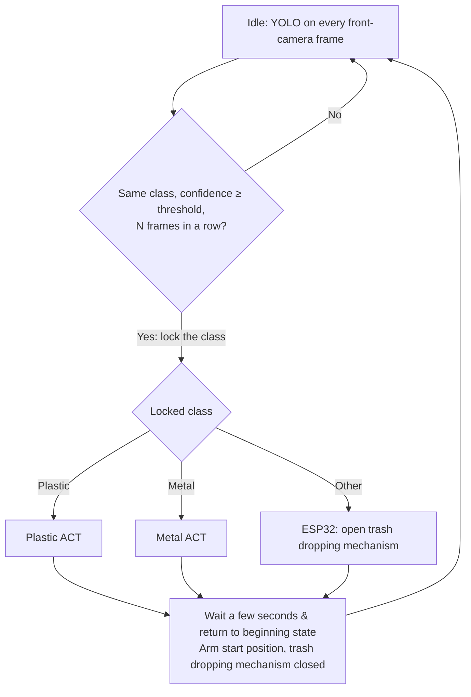

# Cleany_AI_Trash_Sorting_Robot

## Table of contents

- [Purpose](#purpose)
- [Model Pipeline](#model-pipeline)
- [Scripts](#scripts)
- [Cameras and recording performance](#cameras-and-recording-performance)
- [Dataset collection](#dataset-collection)
  - [Record](#record)
  - [Review and manage](#review-and-manage)
  - [Recommendations](#recommendations)
  - [Training](#training)
  - [Sharing trained models](#sharing-trained-models)
- [Running a trained model](#running-a-trained-model)
  - [Available models](#available-models)
  - [Get a model from the cloud](#get-a-model-from-the-cloud)
  - [Run it on the arm](#run-it-on-the-arm)
- [YOLO detector](#yolo-detector)
  - [Use it](#use-it)
  - [Retrain it](#retrain-it)
- [Storing datasets in the cloud](#storing-datasets-in-the-cloud)
  - [Recommended: private Hugging Face Hub dataset repos](#recommended-private-hugging-face-hub-dataset-repos)
  - [One-time setup](#one-time-setup)
  - [Sync commands](#sync-commands)
  - [Team rules](#team-rules)

## Purpose

Sorting trash using lerobot so101 robot arm inside custom made box in which trash is dropped.

If robot detect metal it thrown it in the left hole, if plastic detected it is thrownin the right hole. If neither, signal is given to esp32 conntroller to open floor of trash receiving area and remaining(other) trash is being dropped into mixed bin.

## Model Pipeline



- **YOLO decides once, at the start.** While the arm is idle, YOLO runs on every frame of
  the front camera. Single frames are unreliable while the item is still falling or
  bouncing, so the class is locked only when the same class wins with confidence above a
  threshold for N consecutive frames. Nothing detected means keep waiting.
- **YOLO is not consulted while an ACT runs.** The arm hides the item during the grasp, so
  the class could flip, and switching policies mid-grasp is worse than finishing.
- **ACT models get no YOLO output.** Each material has its own ACT model, so the class is
  already chosen by picking the model. Each ACT finds the item from the camera images alone.
- **The YOLO model needs an `other` class**, so "an item that is neither plastic nor metal"
  can be told apart from "the box is empty". The current YOLO knows only `metal` and
  `plastic` (see [YOLO detector](#yolo-detector)); the `other` class and the pipeline runner
  are not done yet.

## Scripts

All scripts can be run from any directory; they `cd` to the project root themselves.

| Folder                 | Script                   | What it does                                                  |
| ---------------------- | ------------------------ | ------------------------------------------------------------- |
| `scripts/setup/`       | `install_dependencies.sh` | Install system packages, LeRobot and YOLO (Ultralytics) into `.venv` |
| `scripts/calibration/` | `calibrate_leader.sh`, `calibrate_follower.sh` | Calibrate the arms into `calibration/`  |
| `scripts/teleop/`      | `run_teleop.sh`          | Drive the follower with the leader arm, cameras shown in Rerun |
| `scripts/dataset/`     | `record.sh`              | Record teleoperated episodes for one ACT model                |
|                        | `view.sh`                | Browse a recorded episode in Rerun (no robot needed)          |
|                        | `replay.sh`              | Replay a recorded episode on the follower arm                 |
|                        | `delete_last_episode.sh` | Drop the last episode (e.g. a failed demo)                    |
|                        | `sync.sh`                | Push/pull datasets to/from the Hugging Face Hub               |
| `scripts/train/`       | `train_act.sh`           | Train the ACT model of one material (type `exit` to stop and save) |
|                        | `upload_model.sh`        | Upload a trained checkpoint to the Hugging Face Hub           |
| `scripts/run/`         | `run_policy.sh`          | Run a trained ACT model (Hub repo or local folder) on the follower arm |
| `scripts/yolo/`        | `extract_frames.py`      | Take the first front-camera frame of every episode, pre-labelled by the current YOLO |
|                        | `label_studio.sh`        | Local Label Studio for checking and fixing YOLO labels        |
|                        | `extra_frames.py`        | More labelled frames per episode: the ones before the arm reaches the item |
|                        | `prepare_dataset.py`     | Build the YOLO train/val dataset from the labelled frames     |
|                        | `train.sh`               | Train the metal/plastic YOLO (runs the two scripts above first) |
| `scripts/tools/`       | `tune_cameras.sh`        | Lock camera exposure, gain and white balance to the current lighting |
|                        | `preview_augmentation.sh` | Show the training image augmentations on a recorded episode |
|                        | `start_frames.sh`        | One image with the first top-camera frame of every episode    |
| `scripts/config/`      | `hardware.sh`, `datasets.sh` | Ports, cameras, video codec, display, motion limits; model names, tasks, Hub namespace |
|                        | `camera_settings.sh`     | Fixed camera settings written by `tune_cameras.sh`            |
| `scripts/common/`      | `lerobot_wide_fov.py`, `dataset_sync.py` | Helpers used by the scripts above   |

## Cameras and recording performance

Both laptops must capture images that look the same and arrive with the same delay, or a
model trained on data from one laptop behaves differently on the other. The scripts handle
this automatically:

- **Fixed camera settings.** Auto exposure and auto white balance change with the light, so
  images (and frame timing) differ between sessions. `scripts/tools/tune_cameras.sh` finds
  manual settings that match what auto mode picks under the current lighting and saves them to
  `scripts/config/camera_settings.sh`; every script applies them before opening the cameras.
  **Re-run it whenever the lighting or a camera position changes, and commit the file.**
  Without the file, the cameras run in auto mode.
- **30 fps in dim light.** Dynamic frame rate is off and mains is set to 50 Hz on both cameras
  (the front C270 otherwise dropped to ~12 fps).
- **Video encoding on the GPU.** Datasets are encoded with `h264_nvenc` (~3 ms of CPU per
  frame) instead of LeRobot's default CPU AV1 encoder (~100 ms of CPU per frame, enough to
  saturate a weak CPU and delay the cameras). `record.sh` test-encodes first and stops if
  NVENC does not work. Keep `VIDEO_CODEC` the same for the whole team: episodes from both
  laptops end up in the same video files.
- **Display options.** To turn the Rerun viewer off completely (saves CPU on a weak laptop):
  `DISPLAY_DATA=false scripts/dataset/record.sh plastic 10`. If the viewer shows no new data,
  close stale viewers first with `pkill -x rerun`: LeRobot reuses a viewer that is already
  running instead of starting a new one.

## Dataset collection

One dataset per ACT model, picked by the model name (`plastic` or `metal`):

| Model     | Local folder           | Hub repo                   | Task                                     |
| --------- | ---------------------- | -------------------------- | ---------------------------------------- |
| `plastic` | `data/cleany_plastic/` | `cleany-ai/cleany_plastic` | Put the plastic item into the right hole |
| `metal`   | `data/cleany_metal/`   | `cleany-ai/cleany_metal`   | Put the metal item into the left hole    |

**Once per machine:** run `scripts/setup/install_dependencies.sh`, then `.venv/bin/hf auth login`
(see [One-time setup](#one-time-setup)). The arm calibration in `calibration/` is shared via git.

### Record

```bash
pkill -x rerun; scripts/teleop/run_teleop.sh   # 1. check arm and both cameras, Ctrl+C to stop
scripts/dataset/sync.sh pull plastic           # 2. get the shared copy (skip for the first recording)
scripts/dataset/record.sh plastic 10           # 3. record 10 episodes (appends to the dataset)
scripts/dataset/sync.sh push plastic           # 4. upload
```

A **control panel** window opens next to Rerun. It shows the phase, the episode number and a
countdown, and nothing is recorded until you press **Start**:

1. **READY** (not recorded, no time limit): arm at the start position, item in the start zone.
   Press **Start episode**.
2. **RECORDING** (30 s countdown): grasp the item, drop it into its bin, return to the start
   position. Press **End episode** as soon as the arm is back, or let the countdown finish.
3. **RESET** (not recorded, no time limit): put the next item in place, then **Start episode**
   for the next one, or **Discard last episode** if the one you just recorded went wrong.

| Button         | Key (terminal focused) | Effect                                             |
| -------------- | ---------------------- | -------------------------------------------------- |
| Start episode  | **→**                  | Start recording the next episode                   |
| End episode    | **→**                  | End the current episode now                        |
| Discard        | **←**                  | Drop the current (or just recorded) episode, redo it |
| Stop session   | **Esc**                | Stop; episodes recorded so far are kept            |

Options: `record.sh --push plastic 10` uploads at the end; `EPISODE_TIME_S=20` changes the
episode length; `DISPLAY_DATA=false` turns the viewer off; `RECORD_PANEL=false` disables the
panel (plain LeRobot behaviour: episodes start automatically after a `RESET_TIME_S` reset).

### Review and manage

```bash
scripts/dataset/view.sh plastic 9                          # watch episode 9 (counted from 0), no robot needed
scripts/dataset/replay.sh --speed 0.5 --episode 9 plastic  # play it back on the real arm
scripts/dataset/delete_last_episode.sh plastic             # drop the last episode
scripts/dataset/sync.sh status                             # episode counts, local vs Hub
```

To see the start positions of all episodes at once (to spot positions that are missing or
over-represented), make one image per dataset from the first top-camera frame of every episode,
labelled with the episode index:

```bash
scripts/tools/start_frames.sh            # both datasets -> outputs/start_frames/plastic.jpg, metal.jpg
scripts/tools/start_frames.sh metal      # just one
```

To delete other episodes, e.g. 3 and 7, then swap the result in:

```bash
.venv/bin/lerobot-edit-dataset --repo_id=cleany-ai/cleany_plastic --root=data/cleany_plastic \
  --new_root=data/cleany_plastic.edited --operation.type=delete_episodes --operation.episode_indices="[3, 7]"
mv data/cleany_plastic data/cleany_plastic.old && mv data/cleany_plastic.edited data/cleany_plastic
```

After deleting episodes, upload with `scripts/dataset/sync.sh push plastic --force` (the Hub
copy has more episodes, so a normal push refuses).

### Recommendations

- **Same start and end pose** in every episode: the position the pipeline returns the arm to.
- **Vary the items**: different objects, landing spots and orientations in the start zone.
- **Keep the cameras fixed**: never move them between sessions; a moved camera makes earlier
  episodes much less useful. Re-run `scripts/tools/tune_cameras.sh` only when the final
  lighting or a camera changes for good.
- **Vary the lighting a little**: for about a quarter of the episodes, move a lamp or switch the
  room light, with the box light always on. This makes the models robust to light changes.
- **Smooth, decisive moves**: hesitations are copied by the model; re-record (**←**) messy ones.
- **Review before pushing**: watch a few episodes with `view.sh`, drop bad ones.
- **Amount**: 50+ good episodes per model before the first serious training run.
- **One person per model at a time**: pull before recording, push right after (see [Team rules](#team-rules)).

### Training

```bash
scripts/train/train_act.sh plastic --steps=2000   # smoke test
scripts/train/train_act.sh plastic                # full run (100k steps)
```

Checkpoints go to `outputs/train/act_<model>_<timestamp>/checkpoints/`, every 5000 steps
(`SAVE_FREQ=2500` to save more often; each checkpoint is ~0.6 GB).

**To stop early, type `exit` and press Enter** in the training terminal: the step in progress
finishes, a checkpoint of exactly that step is saved (e.g. `checkpoints/054321`) and training
ends. Ctrl+C instead stops immediately and loses everything since the last checkpoint.

Every run starts from scratch in a new folder. To **continue** a stopped or finished run from
its last checkpoint (same folder, same settings, step counter continues):

```bash
scripts/train/train_act.sh plastic --resume                    # latest act_plastic_* run
scripts/train/train_act.sh plastic --resume outputs/train/act_plastic_20261020_1400
STEPS=150000 scripts/train/train_act.sh plastic --resume       # train longer than planned
```

**Image augmentation is on by default**, so the models learn the item's position and shape
rather than its colour (YOLO already decides the material). Each training frame gets 3 random
changes out of: brightness and contrast (±25%), saturation (0.5–1.5×), hue (±0.15, which really
changes object colours), sharpness, and grayscale (about 11% of frames). LeRobot's random image
shift/rotation is left out, because ACT needs exact pixel positions and our cameras are fixed.
The recorded dataset is not changed. The settings are in
[scripts/config/augmentation.json](scripts/config/augmentation.json); to see each one on a
recorded episode (written to `outputs/augmentation_preview/`):

```bash
scripts/tools/preview_augmentation.sh plastic 49
```

To check that augmentation helps, train a second model without it and compare both on the real
robot with objects in colours that are not in the dataset:

```bash
AUGMENT=false JOB_NAME=act_plastic_noaug scripts/train/train_act.sh plastic
```

### Sharing trained models

Upload a checkpoint to a private model repo on the Hugging Face Hub, e.g. to run it on the
other laptop. Repos are named `cleany-ai/<setup>_act_<model>_<YYYYmmdd_HHMM>`, for example
`cleany-ai/setupv2_act_plastic_20261020_1432`:

- `<setup>` (`SETUP_NAME` in [scripts/config/datasets.sh](scripts/config/datasets.sh), now
  `setupv2`): a model only works with the box, cameras, lighting and arm calibration it was
  trained with. Change it whenever the physical setup changes.
- the timestamp is when the checkpoint's last training step finished.

```bash
scripts/train/upload_model.sh plastic --dry-run                # show what would be uploaded
scripts/train/upload_model.sh plastic                          # last checkpoint of the latest run
scripts/train/upload_model.sh plastic outputs/train/act_plastic_20261020_1400 --checkpoint 50000
```

Only the model itself is uploaded (`pretrained_model/` plus a model card with the dataset,
step and settings), not the optimizer state, so an uploaded model can be run but not resumed.
Uploading the same checkpoint twice is refused. All uploaded models:
https://huggingface.co/cleany-ai (filter by `setupv2`).

Download one on another machine (or pass the repo id directly as `--policy.path`):

```bash
.venv/bin/hf download cleany-ai/setupv2_act_plastic_20261020_1432 --local-dir outputs/models/setupv2_act_plastic_20261020_1432
```

## Running a trained model

### Available models

| Model | Where | What it is |
| ----- | ----- | ---------- |
| ACT `plastic` | Hub: [`cleany-ai/setupv2_act_plastic_20261020_1926`](https://huggingface.co/cleany-ai/setupv2_act_plastic_20261020_1926) (public) | `setupv2`, trained on `cleany_plastic` (60 episodes), 100k steps, batch 8, colour augmentation |
| ACT `metal` | not trained yet | |
| YOLO metal/plastic | git: `models/yolo/yolo_cleany_best.pt`, Hub: [`cleany-ai/setupv2_yolo_20261020_2008`](https://huggingface.co/cleany-ai/setupv2_yolo_20261020_2008) (public) | `setupv2` front camera, trained on our own frames; see [YOLO detector](#yolo-detector) |
| YOLO, old | git: `models/yolo/yolo_kaggle_best.pt` | Kaggle photos only, does not work on our camera; kept as the starting point for training |

All models of the team: https://huggingface.co/cleany-ai. Each ACT model only works with
the setup it was trained on (box, camera positions, lighting, arm calibration).

### Get a model from the cloud

A model on the Hub needs no download step: pass its repo id to `run_policy.sh` and it is
downloaded on the first run and cached in `~/.cache/huggingface/`. Public repos need no login;
private ones need `.venv/bin/hf auth login` with a team account (see
[One-time setup](#one-time-setup)).

To keep a copy in the project instead (e.g. to work offline):

```bash
.venv/bin/hf download cleany-ai/setupv2_act_plastic_20261020_1926 --local-dir outputs/models/setupv2_act_plastic_20261020_1926
```

The folder holds the weights (`model.safetensors`), the config and the input/output
normalization (`policy_*processor*`); all of them are needed. A model trained on this machine
is used straight from its checkpoint folder,
`outputs/train/<job>/checkpoints/<step>/pretrained_model`.

### Run it on the arm

1. Plug in the follower arm and both cameras (the leader arm is not needed). Check them with
   `pkill -x rerun; scripts/teleop/run_teleop.sh` if in doubt.
2. Put the arm in its start pose and **one item of the model's material** in the start zone.
   The ACT runs on its own, without YOLO, so it always tries to move the item to its bin.
3. Run the model, staying next to the arm (Ctrl+C stops it):

```bash
scripts/run/run_policy.sh --record false plastic cleany-ai/setupv2_act_plastic_20261020_1926   # from the Hub
scripts/run/run_policy.sh --record true plastic outputs/models/setupv2_act_plastic_20261020_1926   # downloaded copy, saved
scripts/run/run_policy.sh --record false plastic outputs/train/act_plastic_20261020_0133/checkpoints/050000/pretrained_model
scripts/run/run_policy.sh --record false --max-velocity 60 --duration 30 plastic cleany-ai/setupv2_act_plastic_20261020_1926   # slower, 30 s
```

The material argument picks the task text and must match the model's material.

**`--record true|false` is required, there is no default:** decide for every run whether to
save it. With `true`, the run (both camera videos, joint states and the model's actions) is
saved as a LeRobot dataset in `recordings/rollout_<material>_<model>_<YYYYmmdd_HHMMSS>/`
(not committed to git). The script prints the folder at the end; review the run with:

```bash
scripts/dataset/view.sh recordings/rollout_plastic_<model>_<timestamp>                # watch both cameras, no robot needed
scripts/dataset/replay.sh --speed 0.5 recordings/rollout_plastic_<model>_<timestamp>  # repeat the motion on the arm
```

Replays use the speed limits the run had. Recordings are never uploaded; long runs are split
into several episodes (`view.sh <dir> 1` shows the second one).

| Option | Default | Effect |
| ------ | ------- | ------ |
| `--record true\|false` | **required** | Save the run's camera videos, joint states and actions to `recordings/` |
| `--duration S` | 60 | Stop after S seconds; `0` runs until Ctrl+C |
| `--max-velocity DEG_S` | 90 | Max joint speed. Use 60 or less for the first runs of a new model |
| `--acceleration N` | 40 | Servo acceleration, 0–254 |
| `--max-step DEG` | 10 | Max joint change per control step |
| `--device cpu` | `cuda` if available | Run on the CPU, e.g. while a training run uses the GPU (4 GB is not enough for both) |

The cameras are shown in Rerun as during teleoperation (`DISPLAY_DATA=false` turns it off).
The speed limits are written to the servos' RAM when the arm connects, so they last until
the arm is power-cycled or another script connects with its own limits.

## YOLO detector

YOLO finds the items on the table in the front-camera image and says `metal` (class 0) or
`plastic` (class 1); the pipeline uses it to pick which ACT to run.

| | |
| --- | --- |
| Weights | `models/yolo/yolo_cleany_best.pt` (in git, 5 MB), also on the Hub: [`cleany-ai/setupv2_yolo_20261020_2008`](https://huggingface.co/cleany-ai/setupv2_yolo_20261020_2008) |
| Data | the first frame of each `cleany_plastic` (60) and `cleany_metal` (40) episode, one item per frame, plus 60 frames of the same episodes before the arm reaches the item; every 5th episode is held out for validation |
| Validation (20 frames) | mAP50 0.995, mAP50-95 0.87 |
| Unseen photo (8 items, another camera) | all 8 found with the right class at confidence 0.25 |
| Limits | It has seen ~20 different items. New cans and bottles, especially crumpled transparent ones, may be missed or mixed up: record episodes with new items and retrain. |

### Use it

```python
from ultralytics import YOLO
model = YOLO("models/yolo/yolo_cleany_best.pt")
result = model.predict("frame.jpg", conf=0.25)[0]
for cls, conf, box in zip(result.boxes.cls, result.boxes.conf, result.boxes.xyxy):
    print(model.names[int(cls)], float(conf), box.tolist())
```

Run Python from `.venv` with `export YOLO_AUTOINSTALL=false` (`train.sh` sets it): otherwise
Ultralytics may install an OpenCV that breaks LeRobot's. On another machine,
`.venv/bin/hf download cleany-ai/setupv2_yolo_20261020_2008 best.pt --local-dir outputs/models/yolo`
gets the same weights.

### Retrain it

The labelled frames live in `yolo/frames/` (not in git: images, YOLO labels and
`boxes_first.json`), so retraining is done on the laptop that has them.

```bash
scripts/yolo/train.sh                          # ~7 min on the RTX 2050; result in outputs/yolo/<job>/weights/best.pt
scripts/yolo/train.sh epochs=5                 # smoke test
```

`train.sh` fine-tunes `models/yolo/yolo_kaggle_best.pt` for 150 epochs with strong colour
augmentation (hue ±0.1, saturation, brightness), so that the material and not the label colour
decides the class. Tried and found worse on the unseen photo: adding the Kaggle photos to the
training set, and the bigger `yolo26s` model. Copy a better `best.pt` to
`models/yolo/yolo_cleany_best.pt` and commit it.

**Adding newly recorded episodes:**

1. `.venv/bin/python scripts/yolo/extract_frames.py` takes the first frame of every episode
   that has no label yet, boxes the item with the current model and sets the class from the
   dataset name (`cleany_metal` → `metal`). Frames that already have labels are not touched.
2. Check the new boxes: `scripts/yolo/label_studio.sh`, open http://localhost:8080 (login
   and password are printed; the account is local) and import
   `yolo/frames/label_studio_new_tasks.json` with **Import**. Fix wrong or missing boxes;
   copy the corrected ones back into `yolo/frames/labels/<frame>.txt`
   (`<class> <cx> <cy> <w> <h>`, normalized to 0–1).
3. `scripts/yolo/train.sh`.

## Storing datasets in the cloud

### Recommended: private Hugging Face Hub dataset repos

| Option                      | Fit for LeRobot data | Versioning           | Cost / limits          |
| --------------------------- | -------------------- | -------------------- | ---------------------- |
| **Hugging Face Hub**        | Native: training and the dataset viewer load it directly by repo id | Every push is a commit; roll back to any revision | Free private storage up to a quota per account/org |
| Google Drive (via `rclone`) | Plain files only     | None, files are overwritten | Free 15 GB per account |
| S3 / Cloudflare R2          | Plain files only     | Optional bucket versioning | Pay per GB          |
| DVC on top of git           | Plain files only     | Full, tied to git commits | Needs a storage backend anyway |

The Hub is the format LeRobot already uses, so nothing has to be converted: the same repo
can be pulled on any machine (for example a bigger GPU for training) or opened in the
online LeRobot dataset visualizer. Each `push` is a git commit, so a bad upload can be
undone. A LeRobot dataset is a few hundred files (parquet tables + MP4 videos), which suits
the Hub's git/Xet storage much better than Drive.

### One-time setup

1. Create a Hugging Face organization (default name `cleany-ai`; set another in
   `scripts/config/datasets.sh` or via `HF_NAMESPACE=...`) and add the team members.
2. Create an access token with **write** permission at
   https://huggingface.co/settings/tokens and log in on every machine:

   ```bash
   .venv/bin/hf auth login
   ```

Repos are created on the first push, always **private**.

### Sync commands

```bash
scripts/dataset/sync.sh status              # episode counts, local vs Hub, for every model
scripts/dataset/sync.sh push plastic        # upload local → Hub
scripts/dataset/sync.sh pull all            # download Hub → local, every model
```

- `push` uploads the local dataset and makes the Hub copy match it exactly, including
  episodes deleted locally. It refuses if the Hub has more episodes than the local copy.
- `pull` replaces the local copy with the Hub one, keeping the old one in
  `data/cleany_<model>.before_pull/`. It refuses if the local copy has more episodes.
- Add `--force` to skip the episode-count check, e.g. to push after deleting episodes:
  `scripts/dataset/sync.sh push plastic --force`.

### Team rules

- **Pull before you record, push right after.** The Hub copy is the shared truth.
- **One person records a given model at a time.** LeRobot datasets cannot be merged by
  syncing; two people appending to the same dataset in parallel would overwrite each
  other's episodes. To record the same model on two machines in parallel, the second
  machine pushes to a personal namespace instead
  (`HF_NAMESPACE=<your-user> scripts/dataset/sync.sh push plastic`), and the two datasets
  are merged afterwards with `lerobot-edit-dataset --operation.type=merge`.
- Trained models are shared as Hub **model** repos, see
  [Sharing trained models](#sharing-trained-models) and [Running a trained model](#running-a-trained-model).
