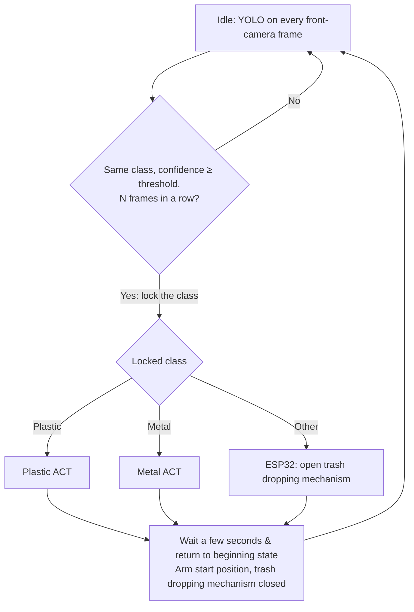

# Cleany_AI_Trash_Sorting_Robot

## Purpose

Sorting trash using lerobot so101 robot arm inside custom made box in which trash is dropped.

If robot detect metal it thrown it in the left hole, if plastic detected it is thrownin the right hole. If neither, signal is given to esp32 conntroller to open floor of trash receiving area and remaining(other) trash is being dropped into mixed bin.

## Model Pipeline



- **YOLO decides once, at the start.** While the arm is idle, YOLO runs on every frame of
  the front camera. Single frames are unreliable while the item is still falling or
  bouncing, so the class is locked only when the same class wins with confidence above a
  threshold for N consecutive frames. Nothing detected means keep waiting.
- **YOLO is not consulted while an ACT runs.** The arm hides the item during the grasp, so
  the class could flip, and switching policies mid-grasp is worse than finishing.
- **ACT models get no YOLO output.** Each material has its own ACT model, so the class is
  already chosen by picking the model. Each ACT finds the item from the camera images alone.
- **The YOLO model needs an `other` class**, so "an item that is neither plastic nor metal"
  can be told apart from "the box is empty". YOLO weights are not in the repo yet; the
  pipeline runner and YOLO scripts will be added with them.

## Scripts

All scripts can be run from any directory; they `cd` to the project root themselves.

| Folder                 | Script                   | What it does                                                  |
| ---------------------- | ------------------------ | ------------------------------------------------------------- |
| `scripts/setup/`       | `install_dependencies.sh`     | Install system packages, LeRobot and YOLO (Ultralytics) into `.venv`              |
| `scripts/calibration/` | `calibrate_leader.sh`, `calibrate_follower.sh` | Calibrate the arms into `calibration/`  |
| `scripts/teleop/`      | `run_teleop.sh`          | Drive the follower with the leader arm, cameras shown in Rerun |
| `scripts/dataset/`     | `record.sh`              | Record teleoperated episodes for one ACT model                |
|                        | `view.sh`                | Browse a recorded episode in Rerun (no robot needed)          |
|                        | `replay.sh`              | Replay a recorded episode on the follower arm                 |
|                        | `delete_last_episode.sh` | Drop the last episode (e.g. a failed demo)                    |
|                        | `sync.sh`                | Push/pull datasets to/from the Hugging Face Hub               |
| `scripts/train/`       | `train_act.sh`           | Train the ACT model of one material                           |
| `scripts/config/`      | `hardware.sh`, `datasets.sh` | Ports, cameras, motion limits; model names, tasks, Hub namespace |
| `scripts/common/`      | `lerobot_wide_fov.py`, `dataset_sync.py` | Helpers used by the scripts above   |

## Recording datasets for the ACT models

There is one dataset per ACT model, selected by the model name `plastic` or `metal`:

| Model     | Local folder           | Hub repo                     | Task text                                  |
| --------- | ---------------------- | ---------------------------- | ------------------------------------------ |
| `plastic` | `data/cleany_plastic/` | `cleany-ai/cleany_plastic`   | Put the plastic item into the right hole   |
| `metal`   | `data/cleany_metal/`   | `cleany-ai/cleany_metal`     | Put the metal item into the left hole      |

Model names, task texts and the Hub namespace live in
[scripts/config/datasets.sh](scripts/config/datasets.sh). `data/` is never committed to git.

### Before the first recording (once per machine)

1. Install the dependencies: `scripts/setup/install_dependencies.sh`
2. Log in to Hugging Face (see [One-time setup](#one-time-setup)): `.venv/bin/hf auth login`
3. Make sure `calibration/` has `leader_arm.json` and `follower_arm.json`; if not, run
   `scripts/calibration/calibrate_leader.sh` and `scripts/calibration/calibrate_follower.sh`.

### How to record a dataset, step by step

The example records the `plastic` model; for the metal one, replace `plastic` with `metal`.

**1. Connect the hardware.** Plug in the leader arm, the follower arm (with its 12 V supply
on), the front camera and the wrist camera. The script stops with
`Error: <device> not found` if one is missing.

**2. Check that everything works** with a quick teleoperation run (Ctrl+C to stop):

```bash
scripts/teleop/run_teleop.sh
```

The follower should copy the leader, and Rerun should show both camera images.

**3. Get the latest shared dataset** so new episodes are appended to it:

```bash
scripts/dataset/sync.sh pull plastic
```

Skip this for the very first recording of a model (the Hub repo does not exist yet).

**4. Start recording**, here 10 episodes:

```bash
scripts/dataset/record.sh plastic 10
```

If asked about calibration, press **ENTER** to use the files in `calibration/`. Rerun
opens with the camera images and joint plots. Keep the **terminal focused**: the
keyboard controls are read from it.

**5. Record each episode.** The script alternates between two phases:

| Phase   | Length (env var)             | What you do |
| ------- | ---------------------------- | ----------- |
| Episode | 30 s (`EPISODE_TIME_S`)      | Is recorded. With the leader arm: reach for the item, grasp it, carry it to the **right hole** (left for metal), release it, return the arm to the start position. |
| Reset   | 10 s (`RESET_TIME_S`)        | Not recorded. Drop the next item into the box and hold the arm at the start position. |

Keyboard controls during recording:

| Key     | Effect |
| ------- | ------ |
| **→**   | End the current episode (or reset) early and save it. Use it as soon as the arm is back at the start position. |
| **←**   | Throw away the current episode and record it again (a failed grasp, a dropped item, a wrong move). |
| **Esc** | Stop the session. Episodes recorded so far are kept. |

Change the lengths for one session with env vars, e.g.
`EPISODE_TIME_S=20 RESET_TIME_S=15 scripts/dataset/record.sh plastic 10`.

**6. Check what you recorded** (no robot needed):

```bash
scripts/dataset/view.sh plastic 9      # episode 9 = the 10th one; episodes count from 0
```

Drop a bad last episode with `scripts/dataset/delete_last_episode.sh plastic` (the
previous version is kept in `data/cleany_plastic.before_delete/`). To see a recording
played back on the real arm, at half speed:

```bash
scripts/dataset/replay.sh --speed 0.5 --episode 9 plastic
```

**7. Upload it:**

```bash
scripts/dataset/sync.sh push plastic
scripts/dataset/sync.sh status         # local and Hub episode counts should match
```

`scripts/dataset/record.sh --push plastic 10` does steps 4 and 7 in one go. Running
`record.sh` again later appends more episodes to the same dataset.

### Tips for good ACT data

- **Same start, same end.** Begin and finish every episode at the same arm start
  position: the one the pipeline returns the arm to between items.
- **Vary what matters.** Use many different items and let them land in different places
  and orientations; that is what the model must generalize over.
- **Keep the rest fixed.** Same lighting, same camera positions, nothing extra in view.
  Moving a camera after recording makes the dataset much less useful.
- **Move smoothly and decisively.** Hesitations and corrections get copied by the model.
  Re-record (**←**) rather than keep a messy episode.
- **Amount.** Aim for 50+ good episodes per model before the first serious training run.

### Training

```bash
scripts/train/train_act.sh plastic --steps=2000   # smoke test
scripts/train/train_act.sh plastic                # full run (100k steps)
```

Checkpoints go to `outputs/train/act_<model>_<timestamp>/checkpoints/`.

## Storing datasets in the cloud

### Recommended: private Hugging Face Hub dataset repos

| Option                      | Fit for LeRobot data | Versioning           | Cost / limits          |
| --------------------------- | -------------------- | -------------------- | ---------------------- |
| **Hugging Face Hub**        | Native: training and the dataset viewer load it directly by repo id | Every push is a commit; roll back to any revision | Free private storage up to a quota per account/org |
| Google Drive (via `rclone`) | Plain files only     | None, files are overwritten | Free 15 GB per account |
| S3 / Cloudflare R2          | Plain files only     | Optional bucket versioning | Pay per GB          |
| DVC on top of git           | Plain files only     | Full, tied to git commits | Needs a storage backend anyway |

The Hub is the format LeRobot already uses, so nothing has to be converted: the same repo
can be pulled on any machine (for example a bigger GPU for training) or opened in the
online LeRobot dataset visualizer. Each `push` is a git commit, so a bad upload can be
undone. A LeRobot dataset is a few hundred files (parquet tables + MP4 videos), which suits
the Hub's git/Xet storage much better than Drive.

### One-time setup

1. Create a Hugging Face organization (default name `cleany-ai`; set another in
   `scripts/config/datasets.sh` or via `HF_NAMESPACE=...`) and add the team members.
2. Create an access token with **write** permission at
   https://huggingface.co/settings/tokens and log in on every machine:

   ```bash
   .venv/bin/hf auth login
   ```

Repos are created on the first push, always **private**.

### Sync commands

```bash
scripts/dataset/sync.sh status              # episode counts, local vs Hub, for every model
scripts/dataset/sync.sh push plastic        # upload local → Hub
scripts/dataset/sync.sh pull all            # download Hub → local, every model
```

- `push` uploads the local dataset and makes the Hub copy match it exactly, including
  episodes deleted locally. It refuses if the Hub has more episodes than the local copy.
- `pull` replaces the local copy with the Hub one, keeping the old one in
  `data/cleany_<model>.before_pull/`. It refuses if the local copy has more episodes.
- Add `--force` to skip the episode-count check, e.g. to push after deleting episodes:
  `scripts/dataset/sync.sh push plastic --force`.

### Team rules

- **Pull before you record, push right after.** The Hub copy is the shared truth.
- **One person records a given model at a time.** LeRobot datasets cannot be merged by
  syncing; two people appending to the same dataset in parallel would overwrite each
  other's episodes. To record the same model on two machines in parallel, the second
  machine pushes to a personal namespace instead
  (`HF_NAMESPACE=<your-user> scripts/dataset/sync.sh push plastic`), and the two datasets
  are merged afterwards with `lerobot-edit-dataset --operation.type=merge`.
- Trained checkpoints are not synced yet. Upload good ones to Hub **model** repos
  (`hf upload --private cleany-ai/act_plastic outputs/train/<job>/checkpoints/last/pretrained_model`).
