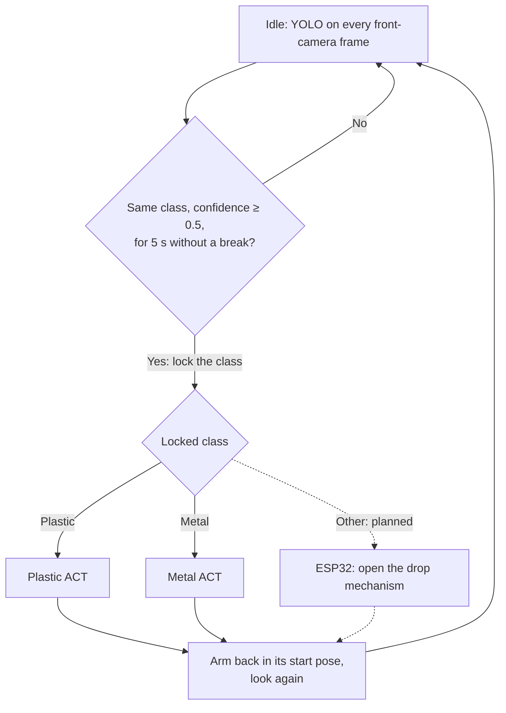

# 🤖 Cleany: AI trash sorting robot

An SO-101 robot arm that looks at an item on the table, recognises whether it is **metal** or
**plastic** with YOLO, and puts it into the matching bin with an ACT imitation-learning policy
trained on our own teleoperated demonstrations. Built with [LeRobot](https://github.com/huggingface/lerobot)
from [`ucu-ai-course/project-template`](https://github.com/ucu-ai-course/project-template).


## Demo

> [!note]
> The demo GIF of the full pipeline on the arm is not recorded yet: see
> [docs/recording-a-demo.md](docs/recording-a-demo.md). Until then, the workspace and what the
> detector sees:


## Team

| Name | GitHub | Role |
|---|---|---|
| Yelyzaveta Bugir | [@lizabugirr](https://github.com/lizabugirr) | YOLO (data, labelling, training, evaluation), ACT training and publishing, sorting pipeline, repository |
| Nazar Pasichnyk | [@dark-neonus](https://github.com/dark-neonus) | Setup and electronics, cameras, dataset recording tools, ACT training tools, pipeline visualisation |

## Problem and motivation

Sorting household trash by material is repetitive work that recycling depends on, and the
items are messy: crushed cans, transparent bottles, caps, odd plastic parts, each lying in a
different pose. A fixed, hand-programmed pick motion does not cope with that variety, but a
policy learned from a few dozen human demonstrations might. The project asks whether a cheap
6-DoF arm (SO-101) plus a laptop GPU can learn to sort one item at a time into a
metal and a plastic bin, with a vision model deciding which policy to run.

## Data

Recorded by us on the arm (no external data in the final models):

| Dataset | Size | Used for |
|---|---|---|
| [`cleany-ai/cleany_plastic`](https://huggingface.co/datasets/cleany-ai/cleany_plastic) | 60 teleoperated episodes, 36 659 frames, 30 fps, 2 cameras | plastic ACT |
| [`cleany-ai/cleany_metal`](https://huggingface.co/datasets/cleany-ai/cleany_metal) | 80 episodes, 43 030 frames | metal ACT |
| [`cleany-ai/cleany_yolo_frames`](https://huggingface.co/datasets/cleany-ai/cleany_yolo_frames) (private) | 100 labelled front-camera frames + 1 unseen test photo | YOLO |

License CC BY 4.0. Full data card (schema, splits, limitations, revisions): [data/README.md](data/README.md).

> [!note] Data and weights are not in git
> `data/` and `models/` hold only their README: the datasets (2.5 GB of video) and the weights
> live on the Hugging Face Hub, versioned by commit, and the scripts download them.

## Approach



- **YOLO decides once, at the start.** Single frames are unreliable while the item still
  moves, so a class is locked only when it wins every frame for a few seconds. Items already in
  a bin are ignored.
- **One ACT policy per material.** The class is chosen by picking the model; each ACT finds the
  item from the two camera images alone and is not given YOLO's box. YOLO is not consulted while
  an ACT runs: the arm hides the item, and switching policies mid-grasp is worse than finishing.
- **Retry, then skip.** If the item is still at the same place afterwards, the ACT tries again;
  after 3 tries the item is skipped until someone moves it.
- **Planned:** an `other` class and an ESP32-driven trap door that drops non-sortable items into
  a mixed bin, once the final box is built.

Models: YOLO26n fine-tuned on our frames (baseline: the same network trained on Kaggle garbage
photos), and two ACT policies (LeRobot 0.6.1, ResNet-18 backbone, action chunks of 100 steps),
100 000 steps each with colour augmentation. Full log, including the rejected runs:
[results/experiments.md](results/experiments.md).

## Results

**YOLO**, generated by `python scripts/yolo/evaluate.py` on 2026-10-23 (`make reproduce`):
validation = 20 held-out episodes; test photo = 8 items shot with another camera on another
table, never used for training.

| Model | Val mAP50-95 | Test photo mAP50-95 | Test photo, items right at conf 0.25 |
|---|---|---|---|
| Baseline: YOLO26n trained on Kaggle photos only | 0.002 | 0.188 | 0 / 8 |
| **YOLO26n fine-tuned on our frames (selected)** | **0.870** | **0.721** | **8 / 8** |
| Same + Kaggle photos in training — *rejected* | 0.869 | 0.653 | 2 plastic items missed |
| YOLO26s (bigger) — *rejected* | 0.858 | 0.655 | 2 extra wrong `metal` boxes |


> [!note] Why the baseline row matters
> The validation numbers saturate (mAP50 = 0.995) because the same cans and bottles appear in
> training and validation episodes. The baseline shows what our own data bought (0.002 → 0.870),
> and the out-of-domain photo is what told the runs apart; one photo with 8 boxes is a small
> test, so we chose on "every item right at the working threshold", not on 0.01 of mAP.

**ACT on the arm** (current pipeline, one item in the start zone, 10 trials per model): plastic
**9/10**, metal **8/10** items put into the right bin. 10 trials is a small sample; larger runs and
new items are next, see [results/experiments.md](results/experiments.md).

## Quick start

```bash
git clone https://github.com/dark-neonus/Cleany_AI_Trash_Sorting_Robot && cd Cleany_AI_Trash_Sorting_Robot
make setup                    # system packages, .venv (Python 3.12, LeRobot, YOLO), dev tools; needs sudo
.venv/bin/hf auth login       # account in the cleany-ai organization (the YOLO frames are private)
make reproduce                # downloads frames + models, prints the YOLO results table above
```

With the hardware (follower arm, front and wrist cameras) plugged in:

```bash
scripts/run/run_pipeline.sh --recording false --dry-run --display    # camera + YOLO only, the arm does not move
scripts/run/run_pipeline.sh --recording true --max-velocity 60 --display   # the full pipeline; stay next to the arm
```

## Documentation

| Guide | What it covers |
|---|---|
| [docs/scripts.md](docs/scripts.md) | Every script in `scripts/` |
| [docs/cameras.md](docs/cameras.md) | Camera settings and recording performance |
| [docs/dataset-collection.md](docs/dataset-collection.md) | Recording, reviewing and cleaning demonstrations |
| [docs/training.md](docs/training.md) | Training ACT, resuming, sharing models |
| [docs/running-models.md](docs/running-models.md) | Available models, downloading, running one ACT on the arm |
| [docs/pipeline.md](docs/pipeline.md) | The sorting pipeline: dry run, on the arm, options |
| [docs/yolo.md](docs/yolo.md) | Using and retraining the detector, labelling new frames |
| [docs/cloud-storage.md](docs/cloud-storage.md) | Hugging Face Hub setup, dataset sync, team rules |
| [electronics/ELECTRONICS.md](electronics/ELECTRONICS.md) | Hardware and power supply |

## Repository structure

```
.
├── scripts/              # all code, by task: setup/ calibration/ teleop/ dataset/ train/ run/ yolo/ tools/,
│                         #   shared config/ (ports, cameras, datasets) and common/ (helpers)
├── config/default.yaml   # which models and datasets the scripts use
├── tests/                # pytest: pipeline decisions, YOLO data split, config
├── data/                 # datasets NOT committed; data/README.md (data card) IS
├── models/               # weights NOT committed; models/README.md (Hub instructions) IS
├── results/              # metrics.json, experiments.md, figures/ — committed, small
├── docs/                 # guides, CONTRIBUTING.md, proposal/, poster/, slides/
├── calibration/          # arm calibration, shared by everyone using the same arms
├── electronics/          # wiring and power
├── assets/               # photos of the setup
└── .github/workflows/    # lint.yml
```

Generated and git-ignored: `outputs/` (training runs), `recordings/` (runs on the arm),
`logs/` (pipeline events), `yolo/` (frames, YOLO datasets, Label Studio).

## Reproducibility

- **Models and data** are pinned by Hub repo and commit: `config/default.yaml` names the models,
  [data/README.md](data/README.md) lists the dataset revisions.
- **Versions**: Python 3.12.14; `requirements.txt` pins the packages (LeRobot 0.6.1,
  PyTorch 2.11 + CUDA 12.8, Ultralytics 8.4.178). `results/metrics.json` records the versions,
  OS and git commit each result was produced with.
- **Seeds**: YOLO trains with Ultralytics' default seed 0 in deterministic mode; LeRobot ACT
  training uses seed 1000 (recorded in each model's `train_config.json`).
- **Hardware tested on**: Ubuntu 26.04, NVIDIA RTX 2050 (4 GB). `make reproduce` takes ~1 min
  and runs on a CPU too; training ACT takes ~18 h per model on that GPU, YOLO ~7 min.
- **What cannot be re-run from git alone**: anything on the arm. It depends on the physical
  setup (bins, camera positions, lighting, calibration), which is why every model name carries
  the setup name (`setupv2_…`).

## Development

```bash
scripts/tools/preview_augmentation.sh plastic 49
```

To check that augmentation helps, train a second model without it and compare both on the real
robot with objects in colours that are not in the dataset:

```bash
AUGMENT=false JOB_NAME=act_plastic_noaug scripts/train/train_act.sh plastic
```

### Sharing trained models

Upload a checkpoint to a private model repo on the Hugging Face Hub, e.g. to run it on the
other laptop. Repos are named `cleany-ai/<setup>_act_<model>_<YYYYmmdd_HHMM>`, for example
`cleany-ai/setupv2_act_plastic_20261020_1432`:

- `<setup>` (`SETUP_NAME` in [scripts/config/datasets.sh](scripts/config/datasets.sh), now
  `setupv2`): a model only works with the box, cameras, lighting and arm calibration it was
  trained with. Change it whenever the physical setup changes.
- the timestamp is when the checkpoint's last training step finished.

```bash
scripts/train/upload_model.sh plastic --dry-run                # show what would be uploaded
scripts/train/upload_model.sh plastic                          # last checkpoint of the latest run
scripts/train/upload_model.sh plastic outputs/train/act_plastic_20261020_1400 --checkpoint 50000
```

Only the model itself is uploaded (`pretrained_model/` plus a model card with the dataset,
step and settings), not the optimizer state, so an uploaded model can be run but not resumed.
Uploading the same checkpoint twice is refused. All uploaded models:
https://huggingface.co/cleany-ai (filter by `setupv2`).

Download one on another machine (or pass the repo id directly as `--policy.path`):

```bash
.venv/bin/hf download cleany-ai/setupv2_act_plastic_20261020_1432 --local-dir outputs/models/setupv2_act_plastic_20261020_1432
```

## Running a trained model

### Available models

| Model | Where | What it is |
| ----- | ----- | ---------- |
| ACT `plastic` | Hub: [`cleany-ai/setupv2_act_plastic_20261020_1926`](https://huggingface.co/cleany-ai/setupv2_act_plastic_20261020_1926) (public) | `setupv2`, trained on `cleany_plastic` (60 episodes), 100k steps, batch 8, colour augmentation |
| ACT `metal` | Hub: [`cleany-ai/setupv2_act_metal_20261021_1855`](https://huggingface.co/cleany-ai/setupv2_act_metal_20261021_1855) (public) | `setupv2`, trained on `cleany_metal` (80 episodes), 100k steps, batch 8, colour augmentation |
| YOLO metal/plastic | git: `models/yolo/yolo_cleany_best.pt`, Hub: [`cleany-ai/setupv2_yolo_20261020_2008`](https://huggingface.co/cleany-ai/setupv2_yolo_20261020_2008) (public) | `setupv2` front camera, trained on our own frames; see [YOLO detector](#yolo-detector) |
| YOLO, old | git: `models/yolo/yolo_kaggle_best.pt` | Kaggle photos only, does not work on our camera; kept as the starting point for training |

All models of the team: https://huggingface.co/cleany-ai. Each ACT model only works with
the setup it was trained on (box, camera positions, lighting, arm calibration).

### Get a model from the cloud

A model on the Hub needs no download step: pass its repo id to `run_policy.sh` and it is
downloaded on the first run and cached in `~/.cache/huggingface/`. Public repos need no login;
private ones need `.venv/bin/hf auth login` with a team account (see
[One-time setup](#one-time-setup)).

To keep a copy in the project instead (e.g. to work offline):

```bash
.venv/bin/hf download cleany-ai/setupv2_act_plastic_20261020_1926 --local-dir outputs/models/setupv2_act_plastic_20261020_1926
```

The folder holds the weights (`model.safetensors`), the config and the input/output
normalization (`policy_*processor*`); all of them are needed. A model trained on this machine
is used straight from its checkpoint folder,
`outputs/train/<job>/checkpoints/<step>/pretrained_model`.

### Run it on the arm

1. Plug in the follower arm and both cameras (the leader arm is not needed). Check them with
   `pkill -x rerun; scripts/teleop/run_teleop.sh` if in doubt.
2. Put the arm in its start pose and **one item of the model's material** in the start zone.
   The ACT runs on its own, without YOLO, so it always tries to move the item to its bin.
3. Run the model, staying next to the arm (Ctrl+C stops it):

```bash
scripts/run/run_policy.sh --record false plastic cleany-ai/setupv2_act_plastic_20261020_1926   # from the Hub
scripts/run/run_policy.sh --record true plastic outputs/models/setupv2_act_plastic_20261020_1926   # downloaded copy, saved
scripts/run/run_policy.sh --record false plastic outputs/train/act_plastic_20261020_0133/checkpoints/050000/pretrained_model
scripts/run/run_policy.sh --record false --max-velocity 60 --duration 30 plastic cleany-ai/setupv2_act_plastic_20261020_1926   # slower, 30 s
```

The material argument picks the task text and must match the model's material.

**`--record true|false` is required, there is no default:** decide for every run whether to
save it. With `true`, the run (both camera videos, joint states and the model's actions) is
saved as a LeRobot dataset in `recordings/rollout_<material>_<model>_<YYYYmmdd_HHMMSS>/`
(not committed to git). The script prints the folder at the end; review the run with:

```bash
scripts/dataset/view.sh recordings/rollout_plastic_<model>_<timestamp>                # watch both cameras, no robot needed
scripts/dataset/replay.sh --speed 0.5 recordings/rollout_plastic_<model>_<timestamp>  # repeat the motion on the arm
```

Replays use the speed limits the run had. Recordings are never uploaded; long runs are split
into several episodes (`view.sh <dir> 1` shows the second one).

| Option | Default | Effect |
| ------ | ------- | ------ |
| `--record true\|false` | **required** | Save the run's camera videos, joint states and actions to `recordings/` |
| `--duration S` | 60 | Stop after S seconds; `0` runs until Ctrl+C |
| `--max-velocity DEG_S` | 90 | Max joint speed. Use 60 or less for the first runs of a new model |
| `--acceleration N` | 40 | Servo acceleration, 0–254 |
| `--max-step DEG` | 10 | Max joint change per control step |
| `--device cpu` | `cuda` if available | Run on the CPU, e.g. while a training run uses the GPU (4 GB is not enough for both) |

The cameras are shown in Rerun as during teleoperation (`DISPLAY_DATA=false` turns it off).
The speed limits are written to the servos' RAM when the arm connects, so they last until
the arm is power-cycled or another script connects with its own limits.

## Running the sorting pipeline

`scripts/run/run_pipeline.sh` puts the models together as in [Model Pipeline](#model-pipeline):
YOLO watches the front camera, and once it is sure about an item it runs the `metal` or
`plastic` ACT, waits until the arm is back in its start pose and looks again. It uses the
models from [Available models](#available-models) (downloaded from the Hub on the first run).

Not in it yet: the ESP32 drop mechanism and the `other` class, since the box and the setup
are not final. Items that are neither metal nor plastic are simply not picked.

### Test without the arm

Check what YOLO sees and what the pipeline would do, with only the front camera plugged in:

```bash
scripts/run/run_pipeline.sh --recording false --dry-run --display
```

Rerun shows the front image with the detections (grey boxes: the bins, whose contents are
ignored); the terminal prints every decision, e.g. `locked cls=metal conf=0.91` and
`act_simulated cls=metal model=...`. Nothing moves: the ACT step only waits 3 s. A recorded
video or a photo works instead of the camera:

```bash
scripts/run/run_pipeline.sh --recording false --dry-run --source data/cleany_metal/videos/observation.images.front/chunk-000/file-000.mp4
```

### Run on the arm

1. Plug in the follower arm and both cameras (no leader arm needed).
2. Put the arm in its **rest pose**, the pose the recordings start and end in: the pipeline
   takes the pose it finds at start as "home", and every ACT run starts and ends there.
3. Put **one item** on the table (in the start zone of the recordings), with the bins in place.
4. Start it and stay next to the arm. Type `exit` + Enter (or Ctrl+C) to stop: the arm eases
   home, and with `--recording true` the video is made after that:

```bash
scripts/run/run_pipeline.sh --recording true --max-velocity 60 --display
```

When the arm has put the item away, put the next one. Every run is logged to
`logs/pipeline/<timestamp>.jsonl` (detections, which model ran, how each run ended).

**`--recording true|false` is required.** With `true` both cameras are recorded to
`recordings/pipeline_<YYYYmmdd_HHMMSS>/` and, once the run ends, `showcase.mp4` is made there:

- the front camera in 720p (960×720, its 4:3 kept), with the wrist camera in sync in the
  bottom-right corner (1/4 of the width);
- while YOLO decides: its boxes with class and confidence, and how long the class has held;
- top-right: `YOLO`, `Plastic ACT` or `Metal ACT`, whichever is in control.

The raw `front.avi`/`wrist.avi` (about 2.5 GB per hour together) stay next to it. To make the
video again, e.g. if it was interrupted: `python scripts/run/pipeline_recording.py recordings/pipeline_<timestamp>`.

| Option | Default | Effect |
| ------ | ------- | ------ |
| `--recording true\|false` | **required** | Record both cameras and make `showcase.mp4` at the end |
| `--dry-run` | off | No arm: front camera (or `--source <video\|image>`), YOLO and decisions only |
| `--display` | off | Show the front image, detections and state in Rerun |
| `--max-velocity DEG_S`, `--acceleration N`, `--max-step DEG` | 90, 40, 10 | Arm speed limits, as for `run_policy.sh` |
| `--conf X` | 0.5 | Minimum YOLO confidence for a detection to count |
| `--lock-seconds S` | 3 | Seconds the same class must win every frame before its ACT runs |
| `--episode-time S` | 60 | Longest ACT run; the arm then goes home anyway (`0`: no limit) |
| `--home-tolerance-deg D` | 12 | How close to the start pose counts as "back home" |
| `--home-still-s S` | 3 | How long the arm must stay near the start pose (twitches are fine) before YOLO looks again |
| `--release-s S`, `--gripper-open P` | 2, 70 | After each run the gripper opens to P (0-100) for S seconds, then closes (`--release-s 0`: off) |
| `--max-attempts N` | 3 | Tries on the same item before it is skipped |
| `--ignore-region X0,Y0,X1,Y1` | the two bins | Area of the 640×480 front image to ignore (repeatable, `none` for no area). Set it again if the bins move |
| `--device cpu` | `cuda` if available | Run the models on the CPU |

Other models: `PLASTIC_MODEL=<repo or folder> METAL_MODEL=... YOLO_MODEL=... scripts/run/run_pipeline.sh`.

### How it decides

1. **Detect.** YOLO runs on every front frame. Items whose centre is inside a bin are
   ignored, so sorted items are not picked again. A class is locked when it is the most
   confident detection (≥ `--conf`) in every frame for `--lock-seconds` (3 s); any other
   result in between starts the count again.
2. **Act.** The locked class's ACT drives the arm at 30 fps; YOLO is not consulted. The run
   ends when the arm has left the start pose (any joint more than 20° away) and has stayed
   within `--home-tolerance-deg` of it for 3 s in a row (`--home-still-s`; small twitches are
   fine; the gripper is not checked, so it may be in any position, e.g. blocked by an item), or after `--episode-time` (60 s). The ACT keeps running during those 3 s.
3. **Home.** The arm is eased back to the exact start pose over 3 s. Then the gripper opens
   for 2 s and closes again, so an item still held (e.g. after a timeout) is dropped, and
   YOLO takes over. This also happens when the pipeline is stopped.
4. **Retry or skip.** If the same class shows up again at the same place, the item was not
   moved and the ACT tries again. After `--max-attempts` tries that class is skipped until
   it has been out of view for 3 s (e.g. you took the item away), so a stuck item does not
   keep the arm busy forever.

## YOLO detector

YOLO finds the items on the table in the front-camera image and says `metal` (class 0) or
`plastic` (class 1); the pipeline uses it to pick which ACT to run.

| | |
| --- | --- |
| Weights | `models/yolo/yolo_cleany_best.pt` (in git, 5 MB), also on the Hub: [`cleany-ai/setupv2_yolo_20261020_2008`](https://huggingface.co/cleany-ai/setupv2_yolo_20261020_2008) |
| Data | the first frame of each `cleany_plastic` (60) and `cleany_metal` (40) episode, one item per frame, plus 60 frames of the same episodes before the arm reaches the item; every 5th episode is held out for validation |
| Validation (20 frames) | mAP50 0.995, mAP50-95 0.87 |
| Unseen photo (8 items, another camera) | all 8 found with the right class at confidence 0.25 |
| Limits | It has seen ~20 different items. New cans and bottles, especially crumpled transparent ones, may be missed or mixed up: record episodes with new items and retrain. |

### Use it

```python
from ultralytics import YOLO
model = YOLO("models/yolo/yolo_cleany_best.pt")
result = model.predict("frame.jpg", conf=0.25)[0]
for cls, conf, box in zip(result.boxes.cls, result.boxes.conf, result.boxes.xyxy):
    print(model.names[int(cls)], float(conf), box.tolist())
```

Run Python from `.venv` with `export YOLO_AUTOINSTALL=false` (`train.sh` sets it): otherwise
Ultralytics may install an OpenCV that breaks LeRobot's. On another machine,
`.venv/bin/hf download cleany-ai/setupv2_yolo_20261020_2008 best.pt --local-dir outputs/models/yolo`
gets the same weights.

### Retrain it

The labelled frames live in `yolo/frames/` (not in git) and are shared as the private Hub
dataset [`cleany-ai/cleany_yolo_frames`](https://huggingface.co/datasets/cleany-ai/cleany_yolo_frames)
(images, YOLO labels, `boxes_first.json`, Label Studio tasks). On a machine without them, get
them first (needs `hf auth login` with a team account):

```bash
.venv/bin/hf download cleany-ai/cleany_yolo_frames --repo-type dataset --local-dir yolo/frames
```

The episode videos are needed too (`extra_frames.py` reads them):
`scripts/dataset/sync.sh pull all`. After adding or fixing labels, upload the frames again:
`.venv/bin/hf upload cleany-ai/cleany_yolo_frames yolo/frames . --repo-type dataset --exclude "*_last*"`.

```bash
scripts/yolo/train.sh                          # ~7 min on the RTX 2050; result in outputs/yolo/<job>/weights/best.pt
scripts/yolo/train.sh epochs=5                 # smoke test
```

`train.sh` fine-tunes `models/yolo/yolo_kaggle_best.pt` for 150 epochs with strong colour
augmentation (hue ±0.1, saturation, brightness), so that the material and not the label colour
decides the class. Tried and found worse on the unseen photo: adding the Kaggle photos to the
training set, and the bigger `yolo26s` model. Copy a better `best.pt` to
`models/yolo/yolo_cleany_best.pt` and commit it.

**Adding newly recorded episodes:**

1. `.venv/bin/python scripts/yolo/extract_frames.py` takes the first frame of every episode
   that has no label yet, boxes the item with the current model and sets the class from the
   dataset name (`cleany_metal` → `metal`). Frames that already have labels are not touched.
2. Check the new boxes: `scripts/yolo/label_studio.sh`, open http://localhost:8080 (login
   and password are printed; the account is local) and import
   `yolo/frames/label_studio_new_tasks.json` with **Import**. Fix wrong or missing boxes;
   copy the corrected ones back into `yolo/frames/labels/<frame>.txt`
   (`<class> <cx> <cy> <w> <h>`, normalized to 0–1).
3. `scripts/yolo/train.sh`.

## Storing datasets in the cloud

### Recommended: private Hugging Face Hub dataset repos

| Option                      | Fit for LeRobot data | Versioning           | Cost / limits          |
| --------------------------- | -------------------- | -------------------- | ---------------------- |
| **Hugging Face Hub**        | Native: training and the dataset viewer load it directly by repo id | Every push is a commit; roll back to any revision | Free private storage up to a quota per account/org |
| Google Drive (via `rclone`) | Plain files only     | None, files are overwritten | Free 15 GB per account |
| S3 / Cloudflare R2          | Plain files only     | Optional bucket versioning | Pay per GB          |
| DVC on top of git           | Plain files only     | Full, tied to git commits | Needs a storage backend anyway |

The Hub is the format LeRobot already uses, so nothing has to be converted: the same repo
can be pulled on any machine (for example a bigger GPU for training) or opened in the
online LeRobot dataset visualizer. Each `push` is a git commit, so a bad upload can be
undone. A LeRobot dataset is a few hundred files (parquet tables + MP4 videos), which suits
the Hub's git/Xet storage much better than Drive.

### One-time setup

1. Create a Hugging Face organization (default name `cleany-ai`; set another in
   `scripts/config/datasets.sh` or via `HF_NAMESPACE=...`) and add the team members.
2. Create an access token with **write** permission at
   https://huggingface.co/settings/tokens and log in on every machine:

   ```bash
   .venv/bin/hf auth login
   ```

Repos are created on the first push, always **private**.

### Sync commands

```bash
scripts/dataset/sync.sh status              # episode counts, local vs Hub, for every model
scripts/dataset/sync.sh push plastic        # upload local → Hub
scripts/dataset/sync.sh pull all            # download Hub → local, every model
```

- `push` uploads the local dataset and makes the Hub copy match it exactly, including
  episodes deleted locally. It refuses if the Hub has more episodes than the local copy.
- `pull` replaces the local copy with the Hub one, keeping the old one in
  `data/cleany_<model>.before_pull/`. It refuses if the local copy has more episodes.
- Add `--force` to skip the episode-count check, e.g. to push after deleting episodes:
  `scripts/dataset/sync.sh push plastic --force`.

### Team rules

- **Pull before you record, push right after.** The Hub copy is the shared truth.
- **One person records a given model at a time.** LeRobot datasets cannot be merged by
  syncing; two people appending to the same dataset in parallel would overwrite each
  other's episodes. To record the same model on two machines in parallel, the second
  machine pushes to a personal namespace instead
  (`HF_NAMESPACE=<your-user> scripts/dataset/sync.sh push plastic`), and the two datasets
  are merged afterwards with `lerobot-edit-dataset --operation.type=merge`.
- Trained models are shared as Hub **model** repos, see
  [Sharing trained models](#sharing-trained-models) and [Running a trained model](#running-a-trained-model).
