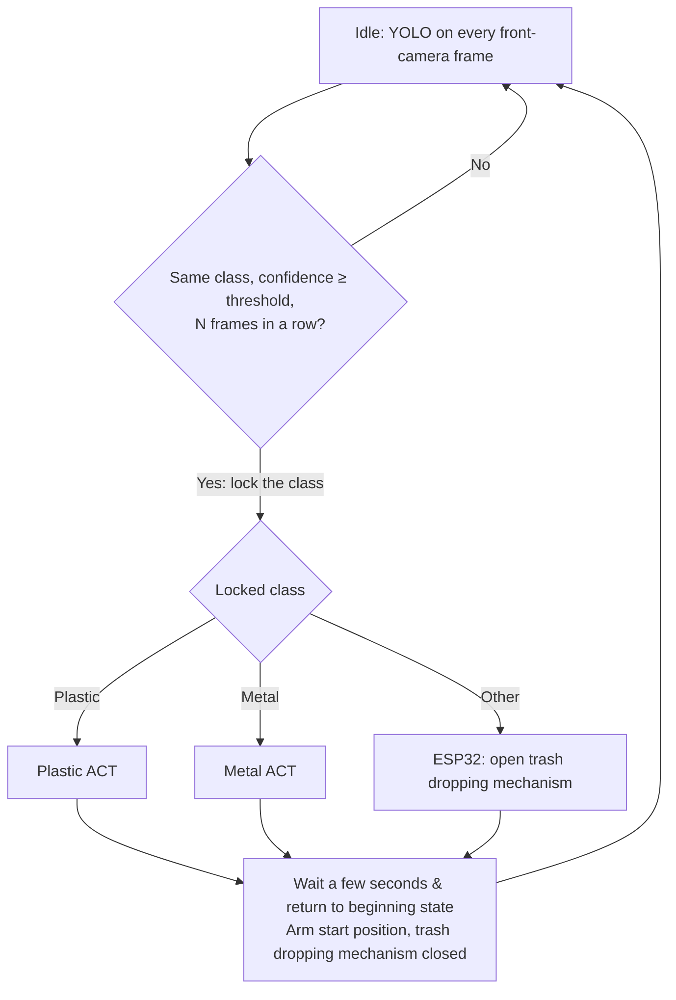

# Cleany_AI_Trash_Sorting_Robot

## Purpose

Sorting trash using lerobot so101 robot arm inside custom made box in which trash is dropped.

If robot detect metal it thrown it in the left hole, if plastic detected it is thrownin the right hole. If neither, signal is given to esp32 conntroller to open floor of trash receiving area and remaining(other) trash is being dropped into mixed bin.

## Model Pipeline



- **YOLO decides once, at the start.** While the arm is idle, YOLO runs on every frame of
  the front camera. Single frames are unreliable while the item is still falling or
  bouncing, so the class is locked only when the same class wins with confidence above a
  threshold for N consecutive frames. Nothing detected means keep waiting.
- **YOLO is not consulted while an ACT runs.** The arm hides the item during the grasp, so
  the class could flip, and switching policies mid-grasp is worse than finishing.
- **ACT models get no YOLO output.** Each material has its own ACT model, so the class is
  already chosen by picking the model. Each ACT finds the item from the camera images alone.
- **The YOLO model needs an `other` class**, so "an item that is neither plastic nor metal"
  can be told apart from "the box is empty". YOLO weights are not in the repo yet; the
  pipeline runner and YOLO scripts will be added with them.

## Scripts

All scripts can be run from any directory; they `cd` to the project root themselves.

| Folder                 | Script                   | What it does                                                  |
| ---------------------- | ------------------------ | ------------------------------------------------------------- |
| `scripts/setup/`       | `install_dependencies.sh` | Install system packages, LeRobot and YOLO (Ultralytics) into `.venv` |
| `scripts/calibration/` | `calibrate_leader.sh`, `calibrate_follower.sh` | Calibrate the arms into `calibration/`  |
| `scripts/teleop/`      | `run_teleop.sh`          | Drive the follower with the leader arm, cameras shown in Rerun |
| `scripts/dataset/`     | `record.sh`              | Record teleoperated episodes for one ACT model                |
|                        | `view.sh`                | Browse a recorded episode in Rerun (no robot needed)          |
|                        | `replay.sh`              | Replay a recorded episode on the follower arm                 |
|                        | `delete_last_episode.sh` | Drop the last episode (e.g. a failed demo)                    |
|                        | `sync.sh`                | Push/pull datasets to/from the Hugging Face Hub               |
| `scripts/train/`       | `train_act.sh`           | Train the ACT model of one material                           |
| `scripts/tools/`       | `tune_cameras.sh`        | Lock camera exposure, gain and white balance to the current lighting |
| `scripts/config/`      | `hardware.sh`, `datasets.sh` | Ports, cameras, video codec, display, motion limits; model names, tasks, Hub namespace |
|                        | `camera_settings.sh`     | Fixed camera settings written by `tune_cameras.sh`            |
| `scripts/common/`      | `lerobot_wide_fov.py`, `dataset_sync.py` | Helpers used by the scripts above   |

## Cameras and recording performance

Both laptops must capture images that look the same and arrive with the same delay, or a
model trained on data from one laptop behaves differently on the other. The scripts handle
this automatically:

- **Fixed camera settings.** Auto exposure and auto white balance change with the light, so
  images (and frame timing) differ between sessions. `scripts/tools/tune_cameras.sh` finds
  manual settings that match what auto mode picks under the current lighting and saves them to
  `scripts/config/camera_settings.sh`; every script applies them before opening the cameras.
  **Re-run it whenever the lighting or a camera position changes, and commit the file.**
  Without the file, the cameras run in auto mode.
- **30 fps in dim light.** Dynamic frame rate is off and mains is set to 50 Hz on both cameras
  (the front C270 otherwise dropped to ~12 fps).
- **Video encoding on the GPU.** Datasets are encoded with `h264_nvenc` (~3 ms of CPU per
  frame) instead of LeRobot's default CPU AV1 encoder (~100 ms of CPU per frame, enough to
  saturate a weak CPU and delay the cameras). `record.sh` test-encodes first and stops if
  NVENC does not work. Keep `VIDEO_CODEC` the same for the whole team: episodes from both
  laptops end up in the same video files.
- **Display options.** To turn the Rerun viewer off completely (saves CPU on a weak laptop):
  `DISPLAY_DATA=false scripts/dataset/record.sh plastic 10`. If the viewer shows no new data,
  close stale viewers first with `pkill -x rerun`: LeRobot reuses a viewer that is already
  running instead of starting a new one.

## Dataset collection

One dataset per ACT model, picked by the model name (`plastic` or `metal`):

| Model     | Local folder           | Hub repo                   | Task                                     |
| --------- | ---------------------- | -------------------------- | ---------------------------------------- |
| `plastic` | `data/cleany_plastic/` | `cleany-ai/cleany_plastic` | Put the plastic item into the right hole |
| `metal`   | `data/cleany_metal/`   | `cleany-ai/cleany_metal`   | Put the metal item into the left hole    |

**Once per machine:** run `scripts/setup/install_dependencies.sh`, then `.venv/bin/hf auth login`
(see [One-time setup](#one-time-setup)). The arm calibration in `calibration/` is shared via git.

### Record

```bash
pkill -x rerun; scripts/teleop/run_teleop.sh   # 1. check arm and both cameras, Ctrl+C to stop
scripts/dataset/sync.sh pull plastic           # 2. get the shared copy (skip for the first recording)
scripts/dataset/record.sh plastic 10           # 3. record 10 episodes (appends to the dataset)
scripts/dataset/sync.sh push plastic           # 4. upload
```

A **control panel** window opens next to Rerun. It shows the phase, the episode number and a
countdown, and nothing is recorded until you press **Start**:

1. **READY** (not recorded, no time limit): arm at the start position, item in the start zone.
   Press **Start episode**.
2. **RECORDING** (30 s countdown): grasp the item, drop it into its bin, return to the start
   position. Press **End episode** as soon as the arm is back, or let the countdown finish.
3. **RESET** (not recorded, no time limit): put the next item in place, then **Start episode**
   for the next one, or **Discard last episode** if the one you just recorded went wrong.

| Button         | Key (terminal focused) | Effect                                             |
| -------------- | ---------------------- | -------------------------------------------------- |
| Start episode  | **→**                  | Start recording the next episode                   |
| End episode    | **→**                  | End the current episode now                        |
| Discard        | **←**                  | Drop the current (or just recorded) episode, redo it |
| Stop session   | **Esc**                | Stop; episodes recorded so far are kept            |

Options: `record.sh --push plastic 10` uploads at the end; `EPISODE_TIME_S=20` changes the
episode length; `DISPLAY_DATA=false` turns the viewer off; `RECORD_PANEL=false` disables the
panel (plain LeRobot behaviour: episodes start automatically after a `RESET_TIME_S` reset).

### Review and manage

```bash
scripts/dataset/view.sh plastic 9                          # watch episode 9 (counted from 0), no robot needed
scripts/dataset/replay.sh --speed 0.5 --episode 9 plastic  # play it back on the real arm
scripts/dataset/delete_last_episode.sh plastic             # drop the last episode
scripts/dataset/sync.sh status                             # episode counts, local vs Hub
```

To delete other episodes, e.g. 3 and 7, then swap the result in:

```bash
.venv/bin/lerobot-edit-dataset --repo_id=cleany-ai/cleany_plastic --root=data/cleany_plastic \
  --new_root=data/cleany_plastic.edited --operation.type=delete_episodes --operation.episode_indices="[3, 7]"
mv data/cleany_plastic data/cleany_plastic.old && mv data/cleany_plastic.edited data/cleany_plastic
```

After deleting episodes, upload with `scripts/dataset/sync.sh push plastic --force` (the Hub
copy has more episodes, so a normal push refuses).

### Recommendations

- **Same start and end pose** in every episode: the position the pipeline returns the arm to.
- **Vary the items**: different objects, landing spots and orientations in the start zone.
- **Keep the cameras fixed**: never move them between sessions; a moved camera makes earlier
  episodes much less useful. Re-run `scripts/tools/tune_cameras.sh` only when the final
  lighting or a camera changes for good.
- **Vary the lighting a little**: for about a quarter of the episodes, move a lamp or switch the
  room light, with the box light always on. This makes the models robust to light changes.
- **Smooth, decisive moves**: hesitations are copied by the model; re-record (**←**) messy ones.
- **Review before pushing**: watch a few episodes with `view.sh`, drop bad ones.
- **Amount**: 50+ good episodes per model before the first serious training run.
- **One person per model at a time**: pull before recording, push right after (see [Team rules](#team-rules)).

### Training

```bash
scripts/train/train_act.sh plastic --steps=2000   # smoke test
scripts/train/train_act.sh plastic                # full run (100k steps)
```

Checkpoints go to `outputs/train/act_<model>_<timestamp>/checkpoints/`.

## Storing datasets in the cloud

### Recommended: private Hugging Face Hub dataset repos

| Option                      | Fit for LeRobot data | Versioning           | Cost / limits          |
| --------------------------- | -------------------- | -------------------- | ---------------------- |
| **Hugging Face Hub**        | Native: training and the dataset viewer load it directly by repo id | Every push is a commit; roll back to any revision | Free private storage up to a quota per account/org |
| Google Drive (via `rclone`) | Plain files only     | None, files are overwritten | Free 15 GB per account |
| S3 / Cloudflare R2          | Plain files only     | Optional bucket versioning | Pay per GB          |
| DVC on top of git           | Plain files only     | Full, tied to git commits | Needs a storage backend anyway |

The Hub is the format LeRobot already uses, so nothing has to be converted: the same repo
can be pulled on any machine (for example a bigger GPU for training) or opened in the
online LeRobot dataset visualizer. Each `push` is a git commit, so a bad upload can be
undone. A LeRobot dataset is a few hundred files (parquet tables + MP4 videos), which suits
the Hub's git/Xet storage much better than Drive.

### One-time setup

1. Create a Hugging Face organization (default name `cleany-ai`; set another in
   `scripts/config/datasets.sh` or via `HF_NAMESPACE=...`) and add the team members.
2. Create an access token with **write** permission at
   https://huggingface.co/settings/tokens and log in on every machine:

   ```bash
   .venv/bin/hf auth login
   ```

Repos are created on the first push, always **private**.

### Sync commands

```bash
scripts/dataset/sync.sh status              # episode counts, local vs Hub, for every model
scripts/dataset/sync.sh push plastic        # upload local → Hub
scripts/dataset/sync.sh pull all            # download Hub → local, every model
```

- `push` uploads the local dataset and makes the Hub copy match it exactly, including
  episodes deleted locally. It refuses if the Hub has more episodes than the local copy.
- `pull` replaces the local copy with the Hub one, keeping the old one in
  `data/cleany_<model>.before_pull/`. It refuses if the local copy has more episodes.
- Add `--force` to skip the episode-count check, e.g. to push after deleting episodes:
  `scripts/dataset/sync.sh push plastic --force`.

### Team rules

- **Pull before you record, push right after.** The Hub copy is the shared truth.
- **One person records a given model at a time.** LeRobot datasets cannot be merged by
  syncing; two people appending to the same dataset in parallel would overwrite each
  other's episodes. To record the same model on two machines in parallel, the second
  machine pushes to a personal namespace instead
  (`HF_NAMESPACE=<your-user> scripts/dataset/sync.sh push plastic`), and the two datasets
  are merged afterwards with `lerobot-edit-dataset --operation.type=merge`.
- Trained checkpoints are not synced yet. Upload good ones to Hub **model** repos
  (`hf upload --private cleany-ai/act_plastic outputs/train/<job>/checkpoints/last/pretrained_model`).
