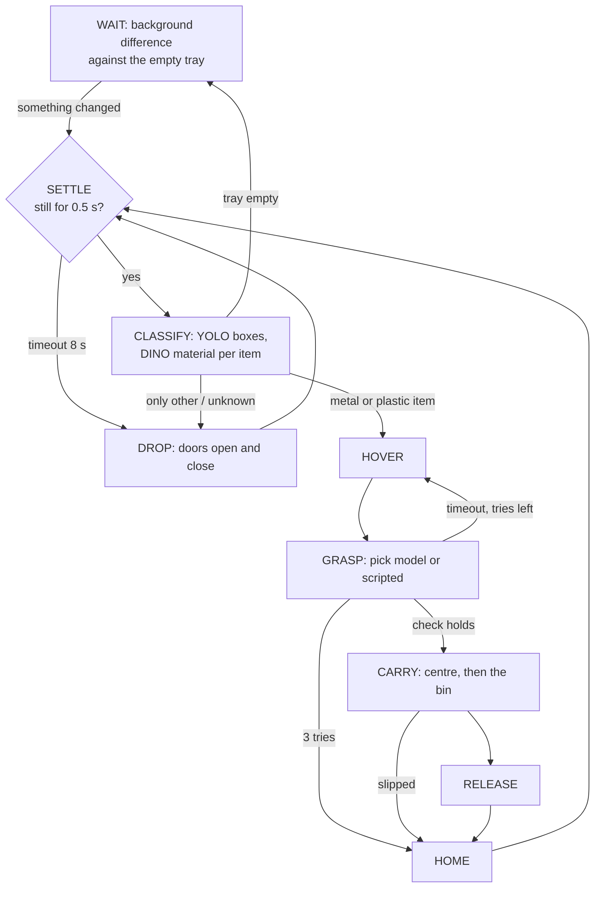

# Box pipeline

Part of the [Cleany README](../README.md). This is the final pipeline from the
[midterm](slides/midterm/midterm.tex) ("New pipeline") as worked out in
[pipeline-proposal.md](pipeline-proposal.md). The old two-ACT pipeline
([pipeline.md](pipeline.md)) stays as plan B.

Math does what is predictable and models do what is not. The models only do two things: say
what an item is, and grasp it. Everything else is minimum-jerk moves between named poses, the
ESP32 doors, and a state machine.



## What is implemented

| Part | Where | State |
| --- | --- | --- |
| State machine, door sequencing, emergency stop handling | [box_states.py](../scripts/run/box_states.py) | Done, tested with a simulated arm, camera and door |
| Background trigger, settle gate, grasp check, moves, target choice | [box_logic.py](../scripts/common/box_logic.py) | Done, unit-tested |
| DINO classifier (metal / plastic / other) | [dino_classifier.py](../scripts/common/dino_classifier.py) | Done; thresholds **uncalibrated** |
| Runner (arm, cameras, ESP32, Rerun, showcase video) | [box_pipeline.py](../scripts/run/box_pipeline.py), [run_box_pipeline.sh](../scripts/run/run_box_pipeline.sh) | Dry run checked on recorded videos; **not yet run on the arm** |
| Pose capture | [capture_poses.sh](../scripts/tools/capture_poses.sh) | Done; no poses captured yet |
| Gallery build and held-out evaluation | [build_gallery.sh](../scripts/tools/build_gallery.sh) | Done; only old-setup crops so far |
| Pick model (hover to lifted) | `grasp.model` in [box_pipeline.yaml](../config/box_pipeline.yaml) | **Not trained**: needs the hover-start dataset recorded in the box |

Not in it yet (later steps of the proposal): the target image as a third camera, several
items with distractor demos, the one-class YOLO, and ACT with a DINOv2 backbone.

## Setting it up in the box

1. **Poses.** With the arm, cameras and box in their final place:

   ```bash
   scripts/tools/capture_poses.sh
   ```

   The torque goes off; move the arm by hand to each pose and press Enter. `hover` also saves
   `outputs/poses/hover_wrist.jpg`: all four tray corners must be visible in it. Redo one
   pose with `scripts/tools/capture_poses.sh hover`. The pipeline refuses to move the arm while
   a pose is missing.
2. **Tray region.** Set `trigger.tray_region` in [box_pipeline.yaml](../config/box_pipeline.yaml)
   to the tray in the 640×480 front image, so the bins and walls are not watched.
3. **Gallery.** Take front-camera crops of the items in the box, as
   `data/box_crops/<metal|plastic|other>/<item>_<n>.jpg` (several per item, items named so the
   evaluation can hold out whole items), then:

   ```bash
   scripts/tools/build_gallery.sh --crops data/box_crops
   ```

   It prints, per `max_distance`, how many held-out crops land in the right bin, the wrong bin,
   or `other`. Set `classifier.max_distance` (and `min_margin`) from that table.
4. **DINOv3.** The default backbone is gated on the Hub. Accept its licence at
   [facebook/dinov3-vits16-pretrain-lvd1689m](https://huggingface.co/facebook/dinov3-vits16-pretrain-lvd1689m)
   and run `hf auth login`. Until then DINOv2 with registers (same size) is used, with a warning.
   Rebuild the gallery after switching: a gallery only works with the backbone it was built with.

## Running

```bash
# No arm: simulated arm and door, the front camera or a recorded video
scripts/run/run_box_pipeline.sh --recording false --dry-run --display
scripts/run/run_box_pipeline.sh --recording false --dry-run --source data/cleany_metal/videos/observation.images.front/chunk-000/file-000.mp4

# On the arm with a scripted grasp (the captured `grasp` pose): tests everything but the model
scripts/run/run_box_pipeline.sh --recording true --display

# On the arm with the pick model
GRASP_MODEL=cleany-ai/<pick model> scripts/run/run_box_pipeline.sh --recording true --grasp policy --display
```

The tray must be empty at start: the empty-tray reference is taken once the doors report
`CLOSED` and the arm is home. Opening the ESP32's port can reset it, which runs one door cycle
first. Stop with `exit` + Enter or Ctrl+C: the arm goes home first. The red emergency stop
button releases the torque; pressed again, the arm stays where it was put, then goes home and
the pipeline continues. Without the drop mechanism use `--door none`: items that cannot be
sorted then wait until you take them out.

Every event goes to `logs/pipeline/box_<timestamp>.jsonl`: triggers, every item with its class,
DINO distances and the reason (`unlike anything known`, `metal vs plastic too close`), grasp
results, slips, drops. With `--recording true`, `showcase.mp4` shows the state top right.

## How it decides

- **Trigger.** Share of tray pixels that differ from the empty reference (after a 4×4 blur)
  above `occupied_fraction`, or any YOLO box. Independent of what the item is.
- **Classify.** YOLO only gives boxes (any class, conf ≥ 0.25). Boxes from `classify_frames`
  settled frames are grouped by overlap; each item's crops are embedded and averaged, then
  compared with the gallery: mean distance to the k nearest crops per class. Metal or plastic
  only when it is the closest class, nearer than `max_distance`, and clearly nearer than the
  other (`min_margin`); otherwise `other`. A wrong bin is worse than the mixed bin.
  `classifier.type: yolo` uses YOLO's own class instead (plan B).
- **Target.** The sortable item with the most free space around it; items overlapping another
  box, or that failed 3 times, are left to the doors.
- **Grasp check.** Both for 0.3 s: the measured gripper stays over 4° above the commanded one
  (fingers blocked by the item), and the lift joint has come back 8° from its lowest point of
  the attempt (lifted). Timeout 10 s: the gripper opens over the tray and it counts as a try.
- **Carry.** The gripper is commanded 3° past where it closed on the item, not fully closed, so
  the servo does not stall. Closing 6° further means the item slipped: home, re-detect.
- **Moves.** Minimum-jerk profile, duration from the largest joint distance at
  `speed_deg_s` (mean), at least `min_move_s`.
- **Stale reference.** If the tray still looks occupied after 2 drops in a row, the reference is
  retaken (the doors just emptied the tray), so a light change cannot make it drop forever.

## Old-setup check of the classifier

`scripts/tools/build_gallery.sh` on the 160 labelled frames of the old setup (each episode held
out in turn):

| max_distance | DINOv3 ViT-S/16: correct / wrong bin / other | DINOv2 ViT-S + registers: correct / wrong bin / other |
| --- | --- | --- |
| 0.30 | 82.5 % / 0.0 % / 17.5 % | 76.9 % / 0.0 % / 23.1 % |
| 0.35 | 93.8 % / 0.6 % / 5.6 % | 87.5 % / 0.0 % / 12.5 % |
| 0.40 | 95.0 % / 0.6 % / 4.4 % | 94.4 % / 0.0 % / 5.6 % |
| 0.50 | 97.5 % / 1.2 % / 1.2 % | 96.9 % / 1.2 % / 1.9 % |

These numbers are **optimistic**: the same cans appear in several episodes, and there are no
`other` items. They only show that the classifier works; the thresholds have to come from crops
taken in the box.

## Kaggle check of the classifier

[`scripts/tools/eval_classifier.py`](../scripts/tools/eval_classifier.py) on the Kaggle
[Garbage Classification](https://www.kaggle.com/datasets/mostafaabla/garbage-classification)
dataset (12 classes; all 769 metal and 865 plastic photos, 150 of each of the other 10 classes as
unknown items), DINOv3 ViT-S/16, `k=5`, `min_margin=0.03`. Run on 2026-11-14.

**1. Our gallery (160 old-setup crops) against Kaggle photos.** Nothing transfers: at
`max_distance` 0.35 every metal and plastic photo goes to `other`; at 0.6, 29 % reach the right
bin and 4 % the wrong one. Unknown items do stay out (100 % up to 0.4). A gallery only works for
the camera and scene it was taken with, so the box gallery must come from the box camera.

**2. In-domain: a gallery of half the Kaggle metal and plastic photos, tested on the other
half and all unknown classes** (every photo is a different item, so this is the real
open-set test):

| max_distance | Right bin | Wrong bin | Sortable sent to other | Unknown kept out | Worst unknown classes |
| --- | --- | --- | --- | --- | --- |
| 0.40 | 76.5 % | 0.7 % | 22.8 % | 95.2 % | white glass 79 %, green glass 81 % |
| 0.50 | 91.6 % | 0.9 % | 7.6 % | 84.3 % | white glass 48 %, green glass 51 %, brown glass 62 % |
| 0.60 | 95.7 % | 1.0 % | 3.3 % | 65.4 % | green glass 20 %, white glass 25 % |

**3. Same, plus 20 photos of each unknown class in the gallery as `other`:**

| max_distance | Right bin | Wrong bin | Sortable sent to other | Unknown kept out | Worst unknown classes |
| --- | --- | --- | --- | --- | --- |
| 0.40 | 76.1 % | 0.7 % | 23.1 % | 98.9 % | white glass 92 % |
| 0.50 | 91.2 % | 0.9 % | 8.0 % | 95.2 % | white glass 78 %, green glass 90 % |
| 0.60 | 95.2 % | 1.0 % | 3.8 % | 92.7 % | white glass 75 %, paper 86 % |

What this means for the box:

- **Metal against plastic is easy for DINOv3**: about 1 % wrong bin at every threshold.
- **Glass is the unknown that looks most like a known class** (clear bottles look like plastic
  ones). With no `other` examples, a threshold that sorts 90 % of recyclables lets half the
  glass into a bin.
- **A few `other` examples fix most of it**: 20 per kind cuts the unknowns that get into a
  bin from 16 % to 5 % at 0.5 (from 35 % to 7 % at 0.6), without costing recyclables. Put glass bottles, paper and cardboard into
  `data/box_crops/other/` when building the box gallery.
- **The threshold is a trade-off to choose on box crops**: around 0.5 on these photos, but the
  scale depends on the camera, so measure it again on the box gallery.

Reproduce (the dataset is about 240 MB):

```bash
uv run --no-project --with kagglehub python -c "import kagglehub; print(kagglehub.dataset_download('mostafaabla/garbage-classification'))"
python scripts/tools/eval_classifier.py --test <that path>/garbage_classification                      # 1
python scripts/tools/eval_classifier.py --test <that path>/garbage_classification --in-domain          # 2
python scripts/tools/eval_classifier.py --test <that path>/garbage_classification --in-domain --other-examples 20   # 3
```
