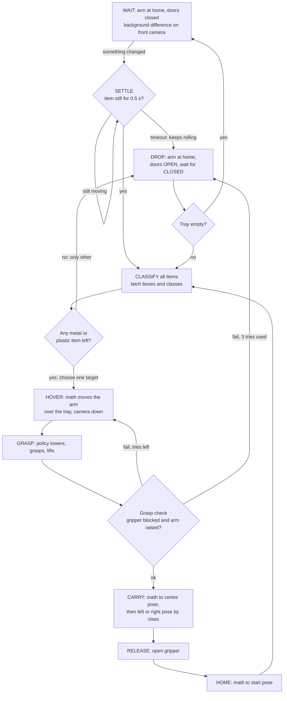

# Pipeline proposal for the final box

Status: proposal, nothing here is implemented. Part of the [Cleany README](../README.md). The
current pipeline is described in [pipeline.md](pipeline.md).

## Summary

Math does what is predictable and models do what is not. Models only do three things: say what
the item is, close the fingers on it, and lift it. Everything else is fixed joint-space motion
and a state machine.

| Question | Proposal |
| --- | --- |
| Detection and classification | Trigger from a background difference (math). Class-agnostic YOLO26n finds items. A **frozen DINOv3 ViT-S encoder with a distance-based classifier** on the crop gives `metal`, `plastic` or `other`, and anything uncertain counts as `other`. |
| Grasp model | **One ACT policy with a frozen DINOv2 ViT-S backbone**, trained only on "from hover to lifted". Diffusion Policy on the same data is the comparison. |
| Passing detection to the policy | Yes, but **as a selection, not as a live signal**. The target box is latched once, before the arm moves, and rendered as a static image in the front-camera frame. |
| Oscillating items | Do not latch until the item has settled. After that nothing depends on the box moving correctly. |
| Several items at once | Feasible with the same mechanism: the detector lists all items, a scheduler picks one, the policy gets that one's box. **Needs demonstrations with distractors**, otherwise the box carries no information during training. |

**One decision is needed before recording:** one hardcoded hover pose or a hover pose per item
(see [Hover pose](#hover-pose-hardcoded-or-per-item)). Changing it later means re-recording the
dataset.

## Why change

What the repo does now ([sort_pipeline.py](../scripts/run/sort_pipeline.py)): YOLO locks a
class, then one ACT per material drives the arm for the whole 18-20 s episode, including the
parts that are the same every time. Results so far are 9/10 (plastic) and 8/10 (metal), on known
items in the old setup.

Measured on our 140 recorded episodes (method and limits in [Measurements](#measurements)):

- **The hard part is short.** From approach to lifted takes a median of 3.1 s, which is about
  17 % of the frames. The other 83 % teach the model motions that a joint interpolation does
  perfectly.
- **Grasps were inconsistent.** Wrist roll at the grasp spans 171° (5th to 95th percentile).
  Another SO-101 project traced about 25 % of its failures to exactly this: ACT
  [averaged two grasp styles into one that matched neither](https://github.com/Lichtphyz/so101-block-to-bin).
- **The old models cannot be reused.** They only work in the setup they were recorded in, and
  the box changes camera positions, background and lighting. New data is needed either way, so
  this is the cheapest moment to change the task definition.

## Proposed pipeline



| State | Owner | What happens | Reuses |
| --- | --- | --- | --- |
| WAIT | Math | Compare the front image with an empty-tray reference. The box has a fixed camera and its own LED strip, so this is predictable. | |
| SETTLE | Math | Wait until the frame difference and box centre stop changing. | |
| CLASSIFY | Model | Detect every item, classify each crop, latch the result. Averaged over the settled frames. | `Detector` |
| DROP | Math | Send `OPEN`, poll until the state is `CLOSED` again. Only with the arm at home. | `DropController` |
| HOVER | Math | Joint-space move to the named pose, gripper open. | `ease_to` |
| GRASP | Model | The policy runs at 30 Hz until the exit condition below. | `Policy` |
| Grasp check | Math | Gripper measured position stays above the commanded one (fingers blocked) and the lift joints have reached the raised range. Experiments already plan this check. | |
| CARRY, RELEASE, HOME | Math | Joint-space moves between named poses, then open the gripper. | `ease_to`, `release_gripper` |

Details that matter when implementing this:

- **Poses are joint values, not coordinates.** Named poses (`home`, `hover`, `centre`,
  `left_bin`, `right_bin`) go in one config file and are captured by moving the arm by hand.
  No URDF or inverse kinematics is needed for the fixed moves. Interpolate with a smooth
  (minimum-jerk or cosine) profile and scale the duration with the distance: `ease_to` is
  linear and always takes 3 s.
- **Hold the item with position, not by squeezing.** During CARRY, command the gripper a few
  degrees past its measured position, not fully closed. Commanding fully closed against an item
  stalls the servo for the whole carry.
- **Watch the grip during CARRY.** If the gripper closes past the grasp position the item has
  slipped. Stop, go home, and re-detect.
- **The policy needs an exit.** It stops when the grasp check holds for about 0.3 s, or at a
  timeout of about 10 s. On timeout, open the gripper over the tray and count one attempt.
- **`other` is also the failure path.** An item the arm cannot pick after 3 tries goes to the
  mixed bin. This replaces today's "block the class until someone removes it", so the machine
  no longer needs a person to clear a stuck item.

## Detection and classification

Three separate jobs need three different answers. Today's YOLO does the last two at once and
cannot do the first.

**1. "Is something new in the tray?" Background difference.** YOLO trained on metal and plastic
may never fire on a banana peel, and then the door never opens. A difference against the empty
tray is independent of what the item is. It is also the settle signal. Its known weak spot is
transparent plastic on a light surface, so the WAIT trigger should also fire on any YOLO
detection.

**2. "Where are the items?" Keep YOLO26n, retrain it as one class (`item`).** It already works,
takes 9 ms per frame on the GTX 1070 and was boxing static items with about 1 px of jitter in
our recordings. One class also makes labelling simpler and lets the detector find items it has
no material label for. [RF-DETR Nano](https://blog.roboflow.com/rf-detr-vs-yolo/) (DINOv2
backbone, Apache 2.0) is the upgrade if YOLO misses items in the box, but it is about 12 times
larger (30.5 M against 2.4 M parameters), its benchmarks come from its authors, and it would
still be closed-set.

**3. "What material is it?" Frozen DINOv3 on the crop.** This is where DINO is worth having:

- The `other` class is unbounded, so it cannot be learned as a normal class. Comparing a crop's
  embedding with stored examples gives an "unlike anything known" answer.
- A frozen encoder with a small head trains in seconds. Adding a new item means adding its
  crops, with no detector retraining.
- [DINOv3 ViT-S/16](https://huggingface.co/facebook/dinov3-vits16-pretrain-lvd1689m/blob/main/README.md)
  has 21 M parameters. A network of that size took about 8 ms per frame on the GTX 1070, so
  several crops per decision are cheap. DINOv2 ViT-S is the fallback if the DINOv3 licence
  terms or Hugging Face access get in the way.

The decision rule should be cost-aware, because the two errors are not equal:

```text
known = distance to the nearest stored metal/plastic crops < threshold
class = metal or plastic only if known and the margin between them is clear
otherwise → other (mixed bin)
```

A wrong item in the metal bin contaminates it, while a can in the mixed bin only loses one
recyclable. Do not use softmax confidence for rejection: on DINOv2 features, a recent preprint
found that on a fine-grained bird dataset [44 % of unknowns with confidence at or above 0.9 were still accepted](https://arxiv.org/html/2605.17818v1).
I found no benchmark for metal against plastic specifically, so this has to be measured on our
items.

**Replace the "same class every frame for 3 s" lock.** Average the embeddings over the settled
frames instead. It is faster and one bad frame no longer restarts the wait.

**Optional later:** classify the wrist close-up at hover too, and abort to the door if it
disagrees with the front view. Metal sheen and bottle transparency are easier to see close up.

**How to evaluate:** split by item, not by episode. The current validation has the same cans in
train and val and saturates at mAP50 0.995, so it cannot tell models apart. Hold out 5-8 items
per class, including `other` items, and report the wrong-bin rate and the rate of recyclables
sent to mixed.

## Grasp model

**Recommendation: ACT with a frozen DINOv2 ViT-S/14 backbone (with registers), one model for
all materials, trained only on hover-to-lifted.**

| Option | Verdict | Why |
| --- | --- | --- |
| ACT, ResNet-18 | **Baseline** | No code changes. Must be beaten to justify anything else. |
| **ACT, DINOv2 ViT-S** | **Recommended** | Pretrained features should tolerate new items and lighting better. In a [simulation benchmark](https://arxiv.org/html/2608.22301) ACT with frozen DINOv2 reached 0.81 on seen tasks, ahead of the other encoder and head pairs tested. |
| Diffusion Policy | **Compare against it** | Ready in LeRobot, no code. Better in principle when one item allows several valid grasps. Evidence is mixed: [8/10 against ACT's 9/10](https://github.com/Lichtphyz/so101-block-to-bin) on SO-101, but [10/10 against 6/10](https://github.com/KirkEHaskell/delta-robot-act-vs-diffusion) on a delta robot. |
| Multi-task DiT (in LeRobot) | Backup | Pretrained CLIP encoder with no custom code, but its text conditioning has no use here and the default 100 inference steps must be reduced. |
| VQ-BeT | Skip | Weakest in the benchmark above. |
| SmolVLA, π0, X-VLA and similar | Out | Too big, as you said. The repo already tried SmolVLA and dropped it. |
| Grasp-pose networks (AnyGrasp and similar) | Out | They need a depth camera. |

Being honest about "generalizes well": no small model does this by itself. In the benchmark
above every model scored under 13 % on unseen tasks without new demonstrations. For us the
gains should come from the following, roughly in order:

1. **The new task definition.** Same start pose, 3-5 s long, wrist camera close to the item.
2. **Variety and consistency in the demonstrations.** Many different items, one grasp rule.
3. **The pretrained encoder.**
4. **Short action chunks.**

Settings to change from today's ACT:

- **`chunk_size` about 45 (1.5 s) instead of 100.** The default 100 steps is 3.3 s, nearly the
  whole new episode.
- **Temporal ensembling** (`temporal_ensemble_coeff=0.01`, `n_action_steps=1`). On another SO-101
  it fixed a model that kept missing the block, without retraining. It needs inference every
  control step, so check the timing: the backbone is about 9 ms per camera on the GTX 1070, and
  the full model was not measured. I could not test the RTX 2050.
- **Keep colour augmentation, no shifts or rotations**, as in
  [train_act.sh](../scripts/train/train_act.sh).

Implementation: LeRobot's `ACTConfig` rejects anything but a ResNet backbone, so this needs a
small custom policy. LeRobot 0.6.1 loads third-party `lerobot_policy_*` packages, and ACT only
needs a backbone that returns `{"feature_map": B×C×H×W}`, so the change is a thin wrapper that
reshapes the DINO patch tokens into a grid. Fine-tuning the last blocks is a later experiment.

**Try after the first working model:** wrist camera only. The front view is mostly blocked by
the arm during the descent, and removing it would make the policy independent of the front
camera position.

## Passing detection to the policy

**Is it reasonable? Yes for choosing the item, no as a live control signal.**

Streaming the box every frame fails where it matters. I ran our YOLO on the recordings:

| Phase | No detection | Wrong class | Box offset from the true position |
| --- | --- | --- | --- |
| Item still, arm away | 0.2 % | 0.4 % | about 1 px (median per-episode std) |
| Arm approaching, early | 20 % | 9 % | 32 px median |
| Arm approaching, near the grasp | 35 % | 8 % | 56 px median |

The box is excellent before the arm moves and unreliable exactly during the phase the policy
controls. So use it once, when it is good.

**Will a box help?** For a single item, probably very little: the policy can already see the
only item. In [VCA](https://arxiv.org/html/2602.23583), which adds SAM2 masks to ACT, success
matched plain ACT in the basic tasks (95/96 and 94/94 %). Its authors conclude that "the mask
primarily provides coarse target localization" and that fine grasping relies on the raw wrist
image. It helps when the policy would otherwise not know which item to take, so it is mainly
the enabler for [several items](#several-items-at-once). A rough box is enough, and no
segmentation model is needed.

**Proposed: a latched target image in the front-camera frame.**

```text
before the arm moves:  box of the chosen item in the front image (median over settled frames)
render once:           640×480 black image with the box filled white
during GRASP:          the same image is fed every step, as a third "camera"
```

- **It stays valid without tracking.** The front camera is fixed and the item is not moving, so
  a box drawn before the arm moved is still pixel-correct while the arm covers the item.
- **No new runtime models or calibration.** No tracker, wrist detector or hand-eye calibration.
- **No change to the model architecture.** ACT passes every image feature through the same
  backbone and appends the tokens, so a third image key works as is.
- **Training matches inference.** Build the target image for each demo by running the same
  detector on the frames before the arm moves, and jitter it by a few pixels as augmentation.

Rejected for now:

| Alternative | Why not |
| --- | --- |
| Box coordinates as a state vector | Four numbers are harder to bind to a location in the image than a spatially aligned map. Quick to test later through `observation.environment_state`. |
| Live tracker with masks (SAM2, EfficientTAM) | VCA needed about 50 ms per frame on a 4070 Ti, more than our whole 33 ms control step, alongside ACT on a 4-8 GB GPU. |
| Blanking everything except the target ([ARRO](https://arxiv.org/html/2505.08627v1)) | Would avoid recording distractors, but needs that same live tracker. |

### What if the item oscillates?

"Oscillating" covers several different problems, each with its own fix:

| What moves | Effect | Handling |
| --- | --- | --- |
| Item still rolling or rocking after the chute | Box is not where the item will end up | **SETTLE gate** before latching. Starting value: box centre moving less than 3 px per frame for 0.5 s. |
| Round item that never settles | Could wait forever | Settle timeout of about 8 s, then send it to the mixed bin. |
| Detector jitter on a still item | About 1 px std, 4 px largest excursion in a typical episode | Harmless. Take the median box over the settled frames. |
| Class flicker | 1 of 35 episodes flipped | Average embeddings over the settled frames. |
| Arm covers the item | Box is lost or shifts 30-56 px | Already solved by latching before the arm moves. |
| Gripper bumps the item during descent | Target image is slightly stale | Accepted. The policy sees the item in the wrist camera and uses the target only as a coarse pointer. If the grasp fails, the state machine re-detects. |
| Item moves a lot after latching | Policy may grasp air | Grasp check fails and the retry re-detects from scratch. |

Because the target is only latched once, there is no noisy input to the 30 Hz loop at all.

## Several items at once

It works with the same mechanism, and it is a natural extension rather than a new system.

```text
loop:
  detect and classify all items (arm at home, nothing covering them)
  sortable = metal and plastic items not yet failed 3 times
  if sortable is empty → open the doors for whatever is left → stop
  target = choose one from sortable
  hover → GRASP with this target's latched image → check → carry → release → home
  (re-detect everything: the scene has changed)
```

Rules this needs:

- **The doors open last.** They drop everything on the tray, so they may only open once no
  sortable item remains. An `other` item waits while the arm clears the rest.
- **Re-detect after every cycle** instead of tracking items across picks. Grasping often shifts
  the neighbours, and re-detecting needs no memory and only costs one settle wait.
- **Choose the easiest target first:** the item with the most free space around its box, so the
  fingers have room. Taking the isolated items first also tends to open up the pile.
- **Overlapping or touching items** are the hard case. If the boxes overlap heavily, treat them
  as unpickable for now, and let the door take them after the sortable items are gone.
- **Items arriving mid-cycle** are picked up by the next re-detect, but an item sliding in while
  the arm is low could hit the gripper. If this happens in tests, the chute needs a gate.

**Main cost: the policy must be trained with distractors.** If every demo has one item, the
target image never disagrees with what is visible, the model learns it can ignore it, and it
will then grasp whichever item looks easiest. Plan for about 30-40 % of the demos to have 1-3
other items in the tray, with the operator always picking the marked one. The recording tool
must show the operator which item is the target.

**Suggested order:** get single items working first with the target image already in place
(always one white box). Then add distractor episodes and compare with and without the target
image. If the policy picks the wrong item at a similar rate either way, the target image is not
working and should not be kept.

## Hover pose: hardcoded or per item

| | One hardcoded pose (as proposed) | Per-item hover |
| --- | --- | --- |
| What it needs | One named pose | Item position → hover pose mapping |
| Work for the policy | Find the item anywhere in the tray | Last few cm only, item is centred in the wrist view |
| Single items | Fine if the wrist camera sees the entire tray | Better, not essential |
| Several items | Relies fully on the target image | Selection is mostly done by where the arm goes |
| Added complexity | None | A calibration step |

In the old data, the shoulder pan at the grasp spans 29°, about 10-13 cm at this arm's reach,
so the items do move around. The CAD shows a narrow tray, which should need less.

**Check first:** put the arm at the candidate hover pose and take a wrist-camera photo. All four
tray corners must be visible with the fingers out of the way. Our wrist camera does not look
straight down along the fingers: in the current setup the gripper sits at the bottom edge of
its image, so "above the tray" and "seeing the tray" may be different poses.

**Recommendation:** use the hardcoded pose if the photo shows the entire tray and single items
are the main goal. If several items are a real goal, go per item from the start.

Per-item hover does not need inverse kinematics either. Move the arm by hand to a grid of 9-16
hover poses over the tray, store each one with the matching front-camera pixel (a marker on the
tray), and interpolate joint angles from the box centre. Small errors do not matter because the
policy closes the last centimetres.

## Data and training plan

**Recording** (needs a change in the tool, since demos now start at hover instead of home):

- Script the follower to the hover pose and only hand control to the leader once the leader
  arm matches it. The blending code in [arm_estop.py](../scripts/common/arm_estop.py)
  already does something similar on resume.
- End the episode when the item is lifted, and exclude the idle start, since another SO-101
  project found that pauses at the start made the policy stall.
- About 150-200 episodes of 4-5 s, with 30+ items across metal, plastic and shapes.
- **One grasp rule, written down:** fingers close across the short side of the item, wrist roll
  chosen the same way each time.
- About 10-15 recovery episodes (first grasp misses, then regrasp).
- Rename the setup: `SETUP_NAME=setupv3`.

**Training:** about 20-25 k frames instead of 80 k, so 50 k steps gives about the same number of
epochs as before, or roughly 9 h on the RTX 2050 by scaling from the current 18 h per 100 k
steps. This is an estimate and I did not run it.

**Evaluation on the arm**, at least 20 trials per condition, on items in no training episode:

| Experiment | Compare | Decides |
| --- | --- | --- |
| 1 | ACT ResNet-18 against ACT DINOv2 | Is the encoder worth the custom code? |
| 2 | Winner against Diffusion Policy | Which action head to keep |
| 3 | With and without target image, with distractors | Does the box help selection? |
| 4 | Wrist only against wrist + front | Is the front camera needed during the grasp? |

Report the wrong-bin rate, grasp success per attempt, and cycle time, per item type. 10 trials
is too few to separate these models: 8/10 is compatible with anything from about 50 % to 95 %.

## Risks to check first

1. **The ESP32 resets when its port opens** and runs a door cycle (open, 2 s, close), so
   anything on the tray at startup falls into the mixed bin. There is no overload detection on
   the doors; every panel has a red emergency stop button that releases the follower's torque.
2. **Items in the door gap or against the tray walls** may be physically ungraspable. The door
   fallback covers these. Measure how often it happens, because a high rate lowers the sorting
   rate without showing up as a model failure.
3. **Gripper limits.** Some items are wider than the gripper opening or too smooth to hold.
   These fail the grasp check and go to the door, which is acceptable if counted as a metric.
4. **The front camera position in the box is not in the repo yet.** The target-image design
   assumes it sees the whole tray and is rigidly mounted. Any later camera move invalidates the
   dataset, as it always has.

## Implementation order

Each step works on its own and leaves the system runnable.

1. **Box checks:** hover photo, named poses captured.
2. **Math skeleton:** state machine with fixed moves and the door, using a scripted fake grasp.
   This can be tested without any model.
3. **Perception:** background trigger, settle gate, one-class YOLO, DINOv3 classifier with
   per-item evaluation.
4. **Recording tool** for hover-start demos, then the first single-item dataset.
5. **Baseline ACT ResNet-18** in the pipeline, with the grasp check.
6. **ACT with DINOv2**, then Diffusion Policy for comparison.
7. **Several items:** distractor episodes, scheduler, target-image comparison.

## Measurements

Run on 2026-11-08 on the local datasets (`cleany_metal`, `cleany_plastic`) from the **old setup**,
on a GTX 1070. The new box may behave differently.

| Quantity | Value | How |
| --- | --- | --- |
| Episodes with a detected grasp | 134 of 140 | Commanded gripper over 4° below measured for 10 frames in a row. A heuristic: it may fire slightly early. |
| Approach to grasp | median 1.7 s (5-95 %: 0.8-3.7) | From the last frame the arm is over 25° away from the grasp pose |
| Grasp to lift | median 1.2 s | Shoulder lift moved 8° from the grasp pose |
| Approach to lift, share of frames | 3.1 s, 17 % | |
| Joint spread at the grasp (5-95 %) | pan 29°, lift 80°, elbow 98°, wrist flex 116°, wrist roll 171° | |
| YOLO on a still item | centre std 0.7 / 1.0 px (x / y), max excursion 4.2 px, wrong class 0.4 %, missed 0.2 % | Medians per episode, 1283 frames from 35 episodes (every 4th), before the arm approaches |
| YOLO outliers | worst episode moved 94 px | Not inspected; could be another box winning, or the item moving |
| YOLO while the arm approaches | see the table above | 996 frames from 34 episodes, offset from that episode's still-item position |
| YOLO latency | 9 ms per 640×480 frame | |
| Backbone latency | ResNet-18 about 6 ms; ViT-S/14-sized network 8-9 ms | **Untrained networks of the same size**, one 640×480 frame or 224-336 px crop. Real weights should take about the same. Not measured on the RTX 2050. |

The YOLO class numbers are optimistic because the sampled episodes include items it was trained
on. The jitter and occlusion results do not depend on that.

## Sources

- [VCA: Vision-Click-Action](https://arxiv.org/html/2602.23583): mask-conditioned ACT, no dedicated distractor experiment.
- [ARRO](https://arxiv.org/html/2505.08627v1): removing distractors from the input image.
- [The Imitator Game](https://arxiv.org/html/2608.22301): frozen encoders with ACT, Diffusion and VQ-BeT heads. The encoder comparison is in simulation.
- [so101-block-to-bin](https://github.com/Lichtphyz/so101-block-to-bin): ACT, Diffusion and SmolVLA on a real SO-101.
- [delta-robot-act-vs-diffusion](https://github.com/KirkEHaskell/delta-robot-act-vs-diffusion): ACT and Diffusion on bolt picking.
- [EGUR-A preprint](https://arxiv.org/html/2605.17818v1): open-set rejection on frozen DINOv2 features.
- [DINOv3 ViT-S/16 model card](https://huggingface.co/facebook/dinov3-vits16-pretrain-lvd1689m/blob/main/README.md) and [DINOv3 paper](https://arxiv.org/html/2508.10104v1).
- [RF-DETR vs YOLO](https://blog.roboflow.com/rf-detr-vs-yolo/): benchmarks by RF-DETR's authors.
