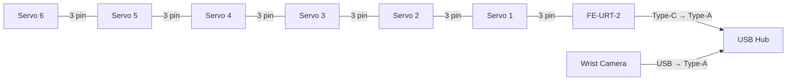
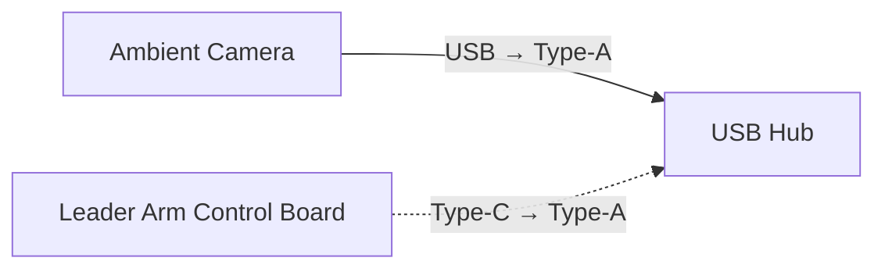
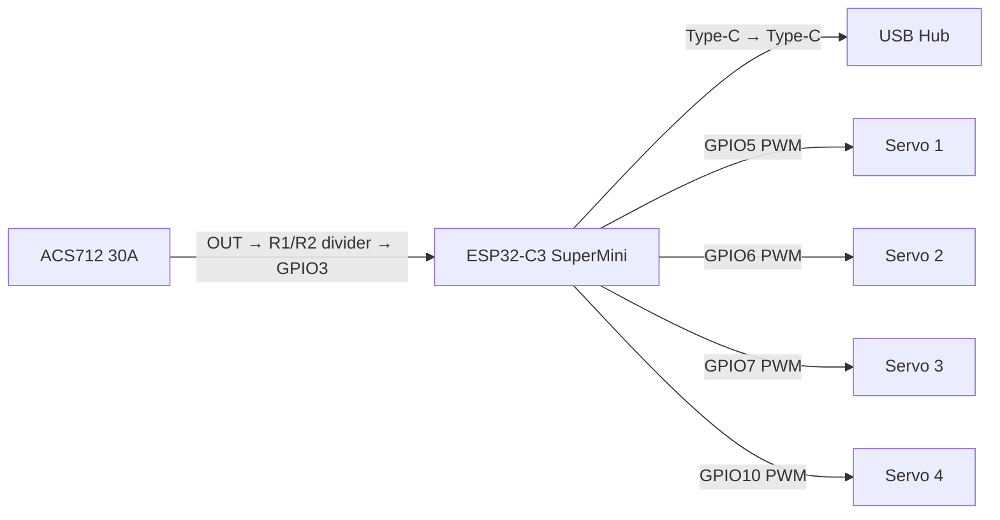
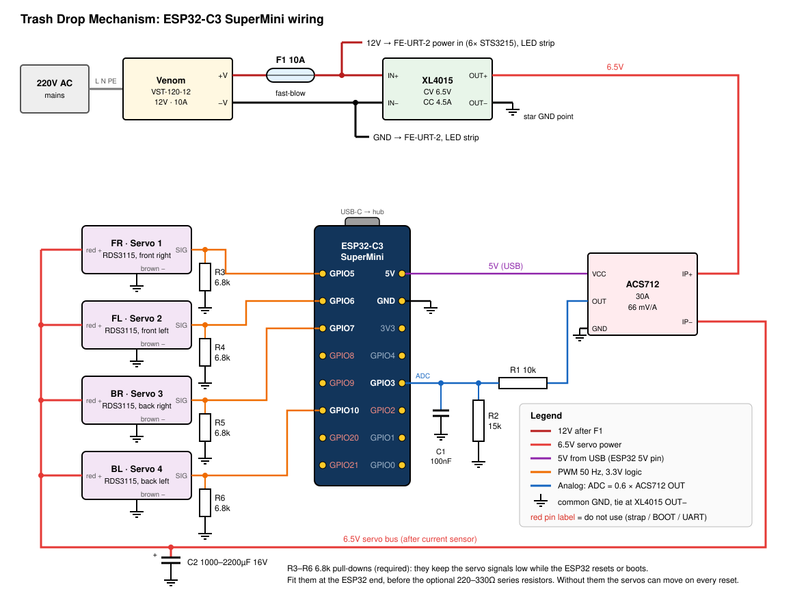
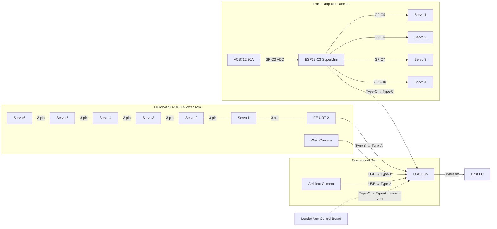
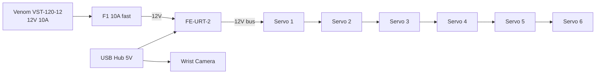
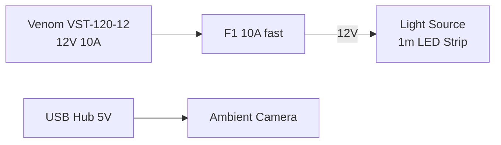
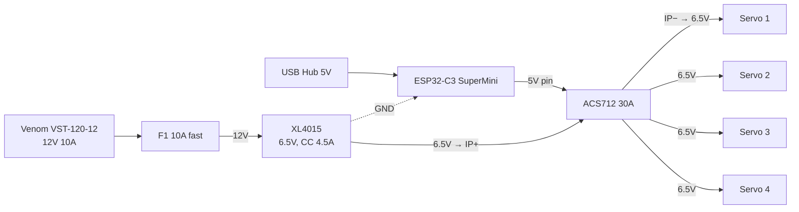
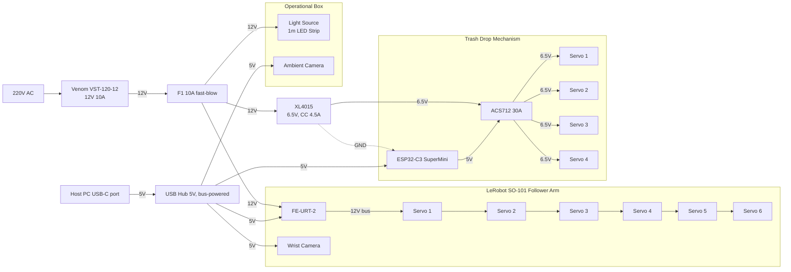

> **Previewing this file in VS Code:** the diagrams are Mermaid blocks. To render them in the built-in Markdown preview (`Ctrl+Shift+V`):
>
> - Install **Markdown Preview Mermaid Support** (`bierner.markdown-mermaid`)
> - Optional: install **Markdown Preview GitHub Styling** (`bierner.markdown-preview-github-styles`) for the GitHub look
> - Disable **Markdown Github Preview** (`lzm0x219.vscode-markdown-github`) and **Mermaid Preview** (`vstirbu.vscode-mermaid-preview`): they conflict with each other and leave diagrams empty or show "No diagram type detected"
> - Reload the window (`Developer: Reload Window`) after changing extensions
>
> On GitHub, the diagrams render without any setup.

## Components

### LeRobot SO-101 (Follower Arm)

- Servos: 6x Feetech STS3215-C001 12V Servo
- Wrist camera: generic UVC camera on an Alpha Imaging Tech. (AIT) chip, reported as "SEMIC Camera"
- Control Board: Feetech FE-URT-2 Servo Debug Programmer, USB Type-C to TTL/RS485 Bus Adapter with CH343P

### Operational Box

- Ambient camera: Logitech Webcam C270 (USB `046d:0825`, 720p UVC)
- Light Source: 1m of LED strip Ecolight 5050 14.4W/m IP20 12V 4000K (60 LED/m, 860 lm/m)
- USB Hub: USB Hub Dynamode USB-C/A 8-in-1 1xUSB-C + 1xUSB 3.0 + 3xUSB 2.0 + 3.5mm audio + SD/TF silver (BYL-2218TU)
- Fuse: F1, 5×20mm cylindrical fast-blow 10A 250V (F10A) in an inline or panel fuse holder, on the Venom 12V output

### Trash Drop Mechanism

- Servos: 4x RDS3115 7.2V 180 deg
- Servo controller: ESP32-C3 SuperMini
- Current sensor: ACS712 30A module (66 mV/A), on the 6.5V servo supply
- Passives: R1 10kΩ, R2 15kΩ (ADC divider), C1 100nF (ADC filter), C2 1000–2200µF 16V (servo bus), R3–R6 6.8kΩ (servo signal pull-downs, required)

## Data Connections

### LeRobot SO-101 (Follower Arm)

Servo bus (daisy chain, 3-pin TTL bus cable):

```
Servo 6 ──3pin── Servo 5 ──3pin── Servo 4 ──3pin── Servo 3 ──3pin── Servo 2 ──3pin── Servo 1 ──3pin── FE-URT-2
```

| From         | Port   | To      | Port   |
| ------------ | ------ | ------- | ------ |
| FE-URT-2     | Type-C | USB Hub | Type-A |
| Wrist Camera | USB    | USB Hub | Type-A |



### Operational Box

| From                     | Port   | To      | Port   |
| ------------------------ | ------ | ------- | ------ |
| Ambient Camera           | USB    | USB Hub | Type-A |
| Leader Arm Control Board | Type-C | USB Hub | Type-A |



> The Leader Arm is outside the scope of this box and is used only for training. One Type-A port on the USB Hub is reserved for it, but it has its own independent power supply (with a shared ground).

### Trash Drop Mechanism

| From                 | Port              | To                   | Port                     |
| -------------------- | ----------------- | -------------------- | ------------------------ |
| ESP32-C3 SuperMini   | Type-C            | USB Hub              | Type-C                   |
| ESP32-C3 SuperMini   | GPIO5 (PWM)       | Servo 1              | signal (orange)          |
| ESP32-C3 SuperMini   | GPIO6 (PWM)       | Servo 2              | signal (orange)          |
| ESP32-C3 SuperMini   | GPIO7 (PWM)       | Servo 3              | signal (orange)          |
| ESP32-C3 SuperMini   | GPIO10 (PWM)      | Servo 4              | signal (orange)          |
| ACS712               | OUT (via R1/R2)   | ESP32-C3 SuperMini   | GPIO3 (ADC1_CH3)         |

Only the signal wire of each servo goes to the ESP32. The red (+) and brown (−) wires go to the 6.5V servo bus (see [Power Supply](#trash-drop-mechanism-3)).



#### ESP32-C3 SuperMini Pinout



| ESP32-C3 pin | Role            | Connects to                                   | Notes |
| ------------ | --------------- | --------------------------------------------- | ----- |
| GPIO5        | PWM (LEDC ch 0) | Servo 1 signal                                 | R3 6.8k pull-down to GND |
| GPIO6        | PWM (LEDC ch 1) | Servo 2 signal                                 | R4 6.8k pull-down to GND |
| GPIO7        | PWM (LEDC ch 2) | Servo 3 signal                                 | R5 6.8k pull-down to GND |
| GPIO10       | PWM (LEDC ch 3) | Servo 4 signal                                 | R6 6.8k pull-down to GND |
| GPIO3        | ADC1_CH3        | ACS712 OUT through R1 10k; R2 15k and C1 100nF to GND | ADC sees 0.6 × ACS712 OUT |
| 5V           | power out       | ACS712 VCC                                     | USB 5V from the hub |
| GND          | ground          | ACS712 GND, R2, C1, XL4015 OUT− (common GND)   | |
| 3V3, GPIO0, GPIO1, GPIO4 | free | —                                     | GPIO4 is a spare ADC1 input |
| GPIO2, GPIO8, GPIO9 | do not use | —                                      | strapping pins; GPIO8 is the onboard LED, GPIO9 is the BOOT button |
| GPIO20, GPIO21 | do not use    | —                                              | UART0 RX/TX: boot messages would twitch the servos |

Pin choice:

- Servos use GPIO5, 6, 7 and 10 because they are on one header and are not strapping or UART pins, so boot messages and strapping don't put pulses on them. The pins still float while the chip resets, so every signal line needs a pull-down (see Servo Signal Pull-downs below).
- The ADC must be on GPIO0–GPIO4 (ADC1). ADC2 (GPIO5) is unreliable on the C3. GPIO2 is a strapping pin, so GPIO3 is used.
- The drawing shows the board from the component side with USB-C up. Clone boards sometimes swap the headers, so wire by the silkscreen labels.

PWM settings: 50 Hz, 500–2500 µs pulse for 0–180°, 14-bit LEDC resolution (the C3 LEDC supports up to 14 bits at 50 Hz). The 3.3V signal is enough for the RDS3115 at 6.5V. Optional: a 220–330Ω series resistor on each signal wire protects the GPIO if a servo connector is plugged in wrong. Put it between the pull-down and the servo, so it doesn't form a divider with the pull-down.

#### Servo Signal Pull-downs (R3–R6, required)

| Resistor | From                   | To  |
| -------- | ---------------------- | --- |
| R3       | Servo 1 signal (GPIO5)  | GND |
| R4       | Servo 2 signal (GPIO6)  | GND |
| R5       | Servo 3 signal (GPIO7)  | GND |
| R6       | Servo 4 signal (GPIO10) | GND |

All 6.8kΩ, 0.125W or larger, any tolerance.

While the ESP32-C3 resets (power-on, the reset button, replugging USB, flashing, opening the serial port) its GPIOs float for a few hundred milliseconds. A floating servo signal picks up noise that the servo reads as pulses, so the servo moves on its own, and when the doors are in the way they can break. A resistor from each signal line to GND holds the line low until the firmware starts the PWM.

- Fit them at the ESP32 end of each signal wire, before the optional series resistor.
- Any value from 4.7kΩ to 10kΩ works. 6.8kΩ costs 3.3V / 6.8kΩ = 0.5mA per pin while the signal is high, and the output stays at 3.3V. Don't go below about 2.2kΩ.
- Power the ESP32 (USB) before the 6.5V rail when you can, so the servos never see a floating signal.
- The pull-downs only cover resets. The firmware still runs its startup open and close each time the board starts.

#### Current Sensing (ACS712 30A)

The ACS712 sits in series in the 6.5V line, between XL4015 OUT+ (to IP+) and the servo bus (from IP−). It measures the total current of all 4 drop servos.

| Quantity                   | Value                                                   |
| -------------------------- | ------------------------------------------------------- |
| ACS712 OUT at 0A           | VCC / 2 ≈ 2.5V                                          |
| Sensitivity                | 66 mV/A at the ACS712 OUT, 39.6 mV/A at GPIO3 (× 0.6)   |
| GPIO3 at 0A / 4.5A (CC limit) | ~1.50V / ~1.68V                                      |
| GPIO3 at the ACS712 output limit (5V) | 3.0V, below the 3.3V GPIO maximum            |
| ADC attenuation            | 11/12 dB (Arduino default), 0–2.5V calibrated range     |

The R1/R2 divider is required. The ACS712 runs on 5V and its output can reach 4.5–5V, which would damage the 3.3V GPIO directly.

Firmware notes:

- Read with `analogReadMilliVolts(3)` and average 16–32 samples (the 30A version is noisy at currents this low: ~0.1–0.2A).
- The ACS712 zero point and sensitivity both scale with its VCC (ratiometric). The SuperMini 5V pin is USB VBUS behind a diode, so it is ~4.6–4.8V, not 5.0V, and the 66 mV/A and 39.6 mV/A figures above drop with it. Measure the zero with the doors closed and still, then use `I = (mV − mV_zero) / (0.0264 × mV_zero)`. Since the zero is VCC / 2 × divider ratio, this formula corrects for the real VCC and cancels the R1/R2 tolerance.
- The 5V pin is shared with the cameras on the USB hub, and its voltage sags when they start streaming. Measured: both cameras starting shifted the reading by about +0.3 A, more than the loads we want to detect. The firmware measures the zero at boot and with a `ZERO` command (open, wait, close, settle, measure) from the panel's CALIBRATE button, and follows slow baseline drift while the doors rest. A separate regulated 5V for the ACS712 would remove the problem.
- Check the 5V pin with a multimeter with everything plugged into the hub: the ACS712 needs at least 4.5V.
- There is no overload detection: the sensor sees the whole 6.5V supply and its baseline wanders by ~0.1 A with servo state and USB load, more than the loads worth detecting. `READ` reports the current for information only. The arm is stopped by the red emergency stop button in the control panels instead.
- The XL4015 current limit (CC 4.5A) stays as the hardware backstop if the firmware hangs.

### All Data Connections



## Power Demand

Values marked *est.* are typical values for this class of device (no datasheet available) and should be verified with a USB power meter.

### LeRobot SO-101 (Follower Arm)

| Item                     | Qty | Voltage | Current (each)                  | Power (each)              | Power (total)                 |
| ------------------------ | --- | ------- | ------------------------------- | ------------------------- | ----------------------------- |
| Feetech STS3215-C001 12V | 6   | 12V     | 0.18A no-load / 2.7A stall      | 2.2W no-load / 32.4W stall | 13W no-load / 194W all stalled |
| FE-URT-2 (CH343P logic)  | 1   | 5V USB  | ~0.03A *est.*                   | ~0.15W                    | ~0.15W                        |
| Wrist Camera (AIT SEMIC) | 1   | 5V USB  | ~0.15–0.25A *est.*, ≤0.5A (USB 2.0 limit) | ~0.75–1.25W    | ~0.75–1.25W                   |

> All 6 servos stalling at once is the worst case and won't happen in normal operation. A realistic peak during fast moves is around 3–5A at 12V.

### Operational Box

| Item                    | Qty | Voltage | Current (each)                     | Power (each) | Power (total) |
| ----------------------- | --- | ------- | ---------------------------------- | ------------ | ------------- |
| LED Strip Ecolight 5050 | 1m  | 12V     | 1.2A                               | 14.4W        | 14.4W (1.2A)  |
| Logitech C270           | 1   | 5V USB  | ~0.2A *est.*, ≤0.5A (USB 2.0 limit) | ~1W         | ~1W           |
| USB Hub BYL-2218TU      | 1   | 5V USB  | ~0.05A *est.* (own consumption)    | ~0.25W       | ~0.25W        |

### Trash Drop Mechanism

| Item               | Qty | Voltage           | Current (each)                              | Power (each)                 | Power (total)                  |
| ------------------ | --- | ----------------- | ------------------------------------------- | ---------------------------- | ------------------------------ |
| RDS3115            | 4   | 6.5V (XL4015)     | 0.1A no-load / 2.5–3A stall (at 6V)         | 0.6W no-load / 15–18W stall (at 6V) | 2.4W no-load / 60–72W all stalled |
| ESP32-C3 SuperMini | 1   | 5V USB            | ~0.03–0.08A typ., up to ~0.35A with Wi-Fi TX *est.* | ~0.15–0.4W typ. / ~1.75W peak | ~0.15–1.75W           |
| ACS712 30A module  | 1   | 5V (ESP32 5V pin) | ~0.013A (incl. power LED) *est.*            | ~0.07W                       | ~0.07W                         |

### Summary per Rail

| Rail          | Consumers                                     | Typical  | Peak (worst case)       |
| ------------- | --------------------------------------------- | -------- | ----------------------- |
| 12V           | 6x STS3215, 1m LED strip, XL4015 input         | ~2.6A / 31W | 20.1A / 241W, limited by the Venom OCP (~10.5–15A) and F1 |
| 6.5V (XL4015) | 4x RDS3115                                     | ~0.4A    | 10–12A, limited to 4.5A by XL4015 CC |
| 5V USB (hub)  | FE-URT-2, Wrist Camera, C270, ESP32-C3, ACS712, hub | ~0.6A / 3W | ~1.4A / 7W       |

> The USB hub is bus-powered, so all 5V USB devices share the current of a single host port: 0.9A on USB 3.0 Type-A, 1.5–3A on Type-C. The Leader Arm board also plugs into this hub, but only for data.

## Power Supply

### Power Modules

| Module | Input | Output | Rated current | Settings | Feeds |
| ------ | ----- | ------ | ------------- | -------- | ----- |
| Venom VST-120-12 Standard IP20 | 220V AC | 12V DC | 10A (120W) | V.ADJ at 12.0V | F1 → FE-URT-2 power input (6x STS3215), LED strip, XL4015 |
| XL4015 CC/CV step-down module | 12V DC (from Venom) | 6.5V DC | 5A peak, ~3A continuous | CV: 6.5V, CC: ~4.5A | ACS712 → 4x RDS3115 |
| USB Hub BYL-2218TU (bus-powered) | 5V from host PC USB-C | 5V | host port limit (1.5–3A on USB-C) | — | FE-URT-2 logic, Wrist Camera, C270, ESP32-C3 (→ ACS712) |

12V budget on the Venom (10A):

| Consumer | Typical | Realistic peak |
| -------- | ------- | -------------- |
| 6x STS3215 (arm) | ~1.1A | ~5A |
| 1m LED strip | 1.2A | 1.2A |
| XL4015 → 4x RDS3115 (12V side, ~90% efficiency) | ~0.25A | ~2.7A at the 4.5A CC limit |
| **Total** | **~2.6A** | **~8.9A** |

> The XL4015 current limit (CC) keeps the drop servos from overloading the Venom when they stall: 4.5A × 6.5V ÷ 0.9 ÷ 12V ≈ 2.7A drawn from 12V.

### Fuse F1

5×20mm cylindrical fast-blow, **10A** (marked `F10A` / `F10AL250V`), in series with the Venom +V output, as close to the terminal as possible, before the 12V split.

- 10A matches the Venom rating and the ≥1.5mm² main wire. The realistic peak (~8.9A) is short and below the rating, and the typical load (~2.6A) is well below the 75% continuous derating (7.5A).
- A smaller fuse (6.3A or 8A) would be cut close by the arm's peaks during fast moves and could blow during normal operation.
- In a hard short the Venom's own overcurrent protection usually trips first (hiccup mode). F1 is the backup for a failed PSU protection and protects the wiring from fire.
- The 250V AC rating is fine for 12V DC. Use a holder rated for ≥10A.
- Optional branch fuses for finer protection: 4A on the XL4015 input, 2A on the LED strip.

### Setup and wiring notes

- Set the Venom output to 12.0V with its V.ADJ trimmer before connecting loads.
- Set the XL4015 before connecting servos: with no load, turn CV to 6.5V (multimeter on the output); then put the multimeter in 10A mode directly across the output and turn CC to ~4.5A.
- Wire: ≥1.5mm² from the Venom through F1 to the 12V split, ≥1mm² to the FE-URT-2 and the XL4015, 0.5mm² to the LED strip. ≥1mm² for the 6.5V path through the ACS712 to the servo split.
- 2200µF 16–25V capacitor across 12V/GND at the FE-URT-2 power input.
- C2 1000–2200µF 16V capacitor across 6.5V/GND at the RDS3115 power split (after the ACS712).
- Common ground: XL4015 OUT− is the star point for the servo grounds, ESP32-C3 GND and ACS712 GND. Without it the servo PWM signals have no reference.
- Fit R3–R6 (servo signal pull-downs) before powering the servos.
- Keep the ACS712 analog wire (OUT → R1 → GPIO3) short and away from the servo power wires. Put R1, R2 and C1 next to the ESP32.
- The Venom has exposed 220V screw terminals (IP20): cover them and mount the unit away from the trash sorting area (dust).

### LeRobot SO-101 (Follower Arm)

| Source     | Voltage | Consumer                                                   |
| ---------- | ------- | ---------------------------------------------------------- |
| USB Hub    | 5V      | FE-URT-2 (logic)                                           |
| USB Hub    | 5V      | Wrist Camera                                               |
| Venom VST-120-12 (via F1) | 12V | FE-URT-2 power input → Servo 1 → Servo 2 → Servo 3 → Servo 4 → Servo 5 → Servo 6 (via bus) |



### Operational Box

| Source     | Voltage | Consumer       |
| ---------- | ------- | -------------- |
| Venom VST-120-12 (via F1) | 12V | Light Source (1m LED strip) |
| USB Hub    | 5V      | Ambient Camera |



### Trash Drop Mechanism

| Source              | Voltage    | Consumer            |
| ------------------- | ---------- | ------------------- |
| USB Hub             | 5V         | ESP32-C3 SuperMini  |
| ESP32-C3 5V pin     | 5V         | ACS712 VCC          |
| Venom VST-120-12 (via F1) | 12V  | XL4015 input        |
| XL4015              | 6.5V       | ACS712 IP+          |
| ACS712 IP−          | 6.5V       | Servo 1–4 (red wire), C2 |



### All Power Connections


