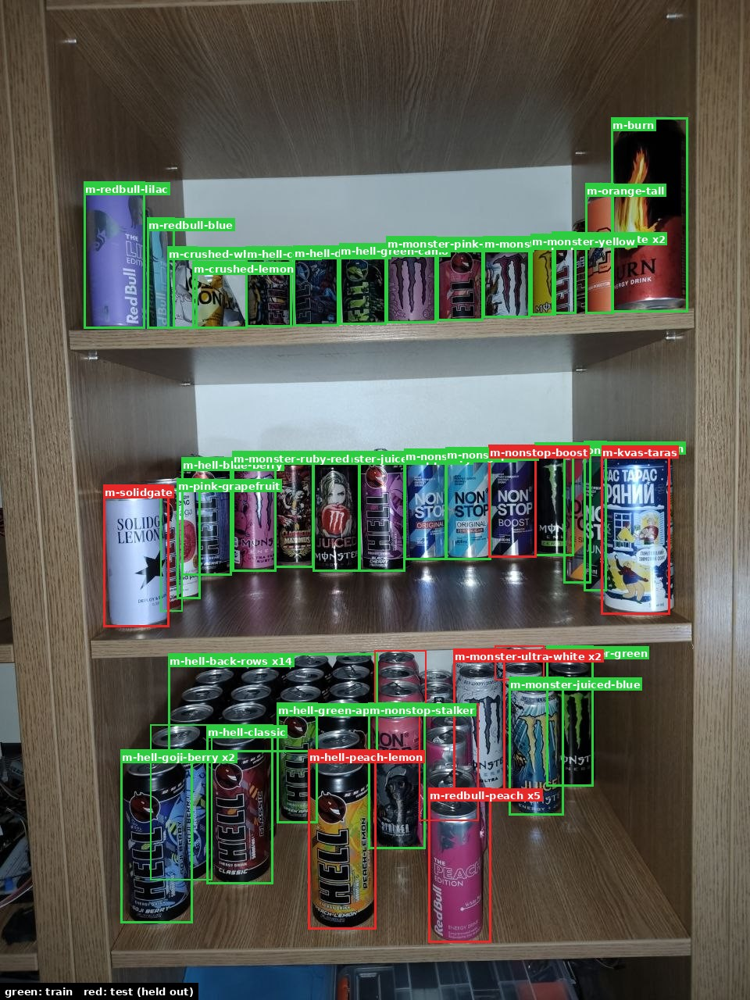
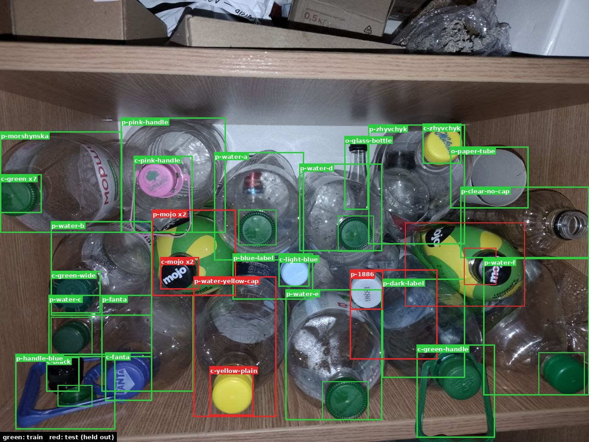

# Object library

Every physical object of the pick dataset, split into **train** (recorded) and **test** (held out,
never seen by any model, only used for the real-world evaluation). The split is by object design; the
strategy is in [docs/collection-plan.md](../docs/collection-plan.md).

```
objects/
├── train/<id>/     shown in the recorder's panel; every record names one of them
│   ├── item.yaml   what it is (below)
│   ├── thumb.jpg   its picture: cut from a shelf photo, or taken by the recorder (Add new object)
│   ├── tray.jpg    its crop on the tray, saved the first time it is recorded (shown instead of thumb.jpg)
│   └── photo.jpg   the full front frame (objects added from the panel only)
└── test/<id>/      held out: same files, never shown in the panel, refused by the recorder,
                    pictures never uploaded (scripts/common/items_sync.py)
```

The folder an object is in is its split. To move an object between train and test, move its folder
(before it is recorded: a recorded object cannot become a test object).

## item.yaml

| Key | |
| --- | --- |
| `id` | the folder name: `m-` metal, `p-` plastic, `c-` cap, `o-` other |
| `class` | `metal`, `plastic` or `other` (anything else: glass, paper, boxes, socks, tools) |
| `kind` | `can`, `bottle`, `cap`, `glass`, `paper`, `object`. Caps are objects of their own, not part of their bottle |
| `name`, `brand`, `design` | what the panel shows; objects of one design share `design` |
| `copies` | identical copies this entry stands for (`c-green x7`: seven near-identical green caps) |
| `target` | records wanted, 3 by default: pick episodes; for `other` objects, Pick other and Save other both count |
| `recorded` | kept records so far, written by the recorder after every record ([data/pick/items/records.jsonl](../docs/pick-dataset.md) is the truth) |
| `source` | where the picture comes from: `{photo, boxes}` (a shelf photo and its boxes, the first is the picture) or `{photo: recorder, session, box}` |
| `crushed`, `notes`, `names` | optional |

## The setup v3 photos

The first 68 entries come from the two shelf photos. Boxes and split:

| [setup_v3_metal_cans_split.jpg](../assets/setup_v3_metal_cans_split.jpg) | [setup_v3_plastic_bottles_split.jpg](../assets/setup_v3_plastic_bottles_split.jpg) |
| --- | --- |
|  |  |

Green: train, red: test. Redraw after a change: `python scripts/tools/draw_objects.py`.

Held out (12 entries, 19 physical objects): the six can designs agreed on 2026-11-23 (Kvas Taras,
Solidgate Lemonade, Red Bull Peach x5, Monster Ultra white x2, Non Stop Boost, Hell Peach-Lemon),
both Mojo bottles, 1886, one clear water bottle (`p-water-yellow-cap`), and the caps of these
bottles (`c-mojo`, `c-1886`, `c-yellow-plain`).

Not in the photos well enough to be told apart: `m-hell-back-rows` stands for the ~14 black Hell cans
behind the front row. When you take them out, add each new flavour with **Add new object**.

## Adding objects

- **Training object**: in the recorder's panel, put the object on the tray, choose its type, type a
  name (optional), press **Add new object** (N). It is photographed, added to `objects/train/`
  and chosen for the next record.
- **Test object**: by hand. Make `objects/test/<id>/` with an `item.yaml` (at least `id`, `class`,
  `kind`, `name`, `design`) and a `thumb.jpg` (any photo of it). The recorder will refuse it.

## Deleting an object

Delete its folder (`rm -r objects/train/<id>`), with the recorder closed; it reads the library at
start. That is all there is to it: there is no button for it in the panel.

- Its recorded data stays (episodes, crops, YOLO frames, lines in `records.jsonl`); only the tile and
  the count go. A record made by mistake is dropped with **Discard** in the panel, before the next one.
- Its id is not given to a new object while records carry it (a new one gets `...-2`).
- Deleting a **test** object removes its protection: the recorder no longer refuses it and the split
  check no longer looks for it. Only do that for an entry that was wrong.
